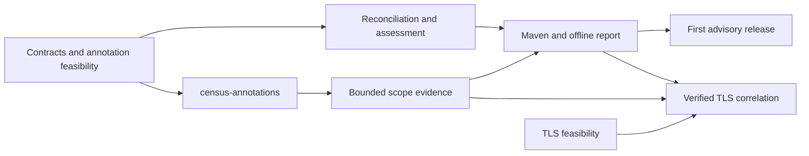

# Business-context implementation plan

Status: reviewed implementation plan; ready for user acceptance. Three completed Claude Opus 5.5
high-effort review rounds; final confirmation reported no High or Medium issues.
Design: [Business context, annotations, and migration assessment](BUSINESS-CONTEXT-DESIGN.md).
Scope: future implementation; no feature code has been implemented by this planning task.

## Delivery strategy

Deliver a complete local workflow first: collect evidence, inspect a report, add business
context, export it, and reassess without rerunning tests. Context edits are exported as change sets and applied
through a validated merge, rather than copying a whole-file replacement over existing answers. Include `census-annotations` in this
first release. Do not require TLS correlation to ship that workflow, and do not label scoped
JCA evidence as completed-handshake evidence.

Develop TLS correlation as a separately gated workstream. Async propagation, catalog-specific
connectors, request-to-connection mappings, portfolio aggregation, and migration enforcement
follow the first advisory release. Each later capability must state its supported boundaries.

The phases below are implementation work packages and dependency guidance, not a competing
task-status tracker. Create/claim implementation tasks in the existing local tracker after
the design is accepted; keep task databases and exports out of Git.

## Phase 0 — Contract fixtures and feasibility gates

Produce versioned JSON schema fixtures for context declarations, per-run evidence, and assessment
output, including context change sets. Define canonical serialization, identity, revision, count, health, and compatibility
rules before implementing producers and consumers independently. Include a sample report data
set with annotated, unannotated, conflicting, overflowed, and unobserved flows.

Run a small annotation instrumentation experiment against existing agent infrastructure:
name-based metadata access across isolated classloaders; static/instance/overloaded methods;
normal/exceptional exit; retransformation; supported proxy cases; and no annotation dependency
in the bootstrap agent. Resolve transformation failure cleanup before adopting the public API. Prove separate enrichment
transformer failure isolation, primitive-only bridge visibility, a zero/no-op entry token, and
a bounded idempotent binding registry. Include recoverable stack-exhaustion tests and the undetectable-resource-failure
limitation. Use annotated Liberty/WildFly fixtures, including safe
unsupported-loader behavior. Benchmark descriptor prefiltering and shaded annotation matching.

In parallel when scheduled, investigate TLS hooks on supported runtime families, separately
for sockets and engines. Record exact hook signatures and an executable completion/group
correlation fixture, including SSLEngine delegated tasks on separate threads. A vendor/version without reliable correlation is unsupported for that
capability, not grounds for inferring relationships.

This phase has two independently closable gates. The first-release gate requires approved
schema/example fixtures and feasible annotation instrumentation without behavior changes. The
TLS gate requires an explicit support matrix and go/no-go decisions for subsequent adapters;
it does not block Phases 1–5.

## Phase 1 — Public annotations artifact

Add `census-annotations` to the Maven reactor, dependency management, release artifacts, license
checks, and documentation. Implement `CryptoFlow`, `CryptoPurpose`, and `DataProtection` exactly
as specified in the design, plus the infrastructure annotation-type API marker. Keep Java 17
compatibility and zero runtime dependencies.

Document annotation retention, method-only targets, no inherited interface annotations,
duplicate flow IDs, classification identifiers, lifetime semantics, and absent-agent behavior.
Provide examples for confidentiality, authenticity, and identity-only declarations.

Exit criteria:

- An ordinary Java application compiles/packages/runs with annotations and no agent.
- Reflection/bytecode fixtures establish retention and defaults; binary packaging contains no
  instrumentation or framework dependency.
- Public API and examples agree; invalid values receive documented agent diagnostics later.

Depends on Phase 0 annotation contract. Do not change existing public asset identity. Include the annotation-type API marker and
automatic module name; test runtime-unresolvable annotation types as a diagnosed gap.

## Phase 2 — Bounded evidence and annotation collection

Add versioned evidence DTOs and bounded aggregate/IO support to `census-core`. Extend agent
collection with annotation discovery, balanced scope entry/exit, direct flow attribution, bounded
path-specific aggregates, project-owned/main/test frames,
and separate enrichment health. Use the bounded artifact map for packaged Failsafe and reactor
code; derive declaration identity from declaring artifacts or explicit product mappings rather
than the test runner module. Retain existing asset aggregation and JCA event semantics.
Expose the inventory keep/fold/drop outcome and use its effective occurrence for attribution.
Keep no-scope and scope-lost separate; share write-time folding and drained snapshots. Retain
all applicable outer-flow requirements instead of letting a shared inner helper weaken them.

Use the shared public annotation names without shading or bootstrap type linkage. Document
that unloaded classes and unexecuted code do not become complete source inventory. Keep
synchronous-only scope support explicit; do not add automatic executor propagation here.

Implement per-run evidence sidecar output, safe-write behavior, run identity, CBOM hash pairing,
and bounded shutdown snapshotting. Embed a fresh nonce inside the CBOM properties and hash
the exact serialized buffer. The paired inventory/evidence snapshot must reconcile, or expose
drain/saturation uncertainty without inventing a numeric missing count. Isolate attribution
exceptions after the core recording update; give sidecar serialization its own budget after
CBOM publication. Emit the nonce only when enrichment is enabled.

Exit criteria:

- Two flows sharing a helper remain separate; nested/recursive observations count once.
- Enrichment installation/per-class transformation failure leaves ordinary inventory and gates
  unchanged, including attribution and sidecar failures. Scope entry/exit fault injection verifies
  balancing tokens, parent restoration and detected resource-failure invalidation. Test
  enrichment-disabled metadata compatibility and a sidecar that exceeds its own timeout.
- Exception, failed entry, depth overflow, virtual-thread, classloader unload, and worker reuse
  fixtures show no context leakage and no changed application result.
- Sidecar mismatch, truncation, stale output, failed write, and abrupt shutdown produce explicit
  incomplete evidence. Original CBOM consumers remain unaffected.
- Cardinality and memory stress prove bounds and visible loss counters; bytecode and app-server
  compatibility checks cover the supported annotation paths.

Depends on Phases 0–1.

## Phase 3 — Declaration reconciliation and assessment

Add `census-assessment` with context validation, field-level source reconciliation, stable
identity, stale-resolution detection, and a versioned rules engine. Implement the design’s ordered decision table, complete
policy-profile hashing, classification mapping and configurable planning thresholds. Unmapped
classifications require context; observations can establish a primitive role without a purpose annotation.
Extend canonical core policy facts with an orthogonal quantum-exposure axis and role; assessment
consumes these facts instead of maintaining a second algorithm catalog. Broken/weak technical
findings use technical-remediation-first and cannot be demoted below a safer classical use.

Implement findings that retain technical verdicts and distinguish business priority, readiness,
association strength, and coverage. Include rules for confidentiality and authenticity;
never rank signatures as universally less urgent. Treat failed attribution and conflicts as
assessment gaps, without discarding independently known risk.

Exit criteria:

- Golden scenario fixtures produce deterministic reason codes and next actions.
- All supported source combinations, explicit resolutions, revision changes, application
  defaults, unknown values, and retired/unobserved flows round-trip without silent overwrites. Change-set application locks,
  reloads, three-way merges and atomically writes; concurrent/disjoint/conflicting edits are tested.
- No-count/no-crypto input, observed PQC, and missing data cannot become unqualified readiness.
- Rule version and input provenance make results reproducible across assessment-only runs. Permuting equivalent inputs yields byte-identical
  canonical assessment output, including same-flow/different-path and occurrence ties. Compare
  RSA-1024 and RSA-2048 in the same 20-year confidential flow; test acceptable TLS suite evidence
  with a separately proven vulnerable exchange. Route not-established exposure to needs-context
  and assert independent technical priority even with missing business context. Readiness assertions cannot masquerade as validation evidence.

Depends on Phase 0 schemas; integration requires Phase 2 evidence.

## Phase 4 — Maven orchestration and offline guided report

Extend the plugin with opt-in reporting and new assessment-only and context-apply goals, finalizing parameter
names in the plugin descriptor and executable fixtures. Reuse the existing discovery and
merge infrastructure while validating sidecar pairing and namespacing run-local identities.
Generate JSON plus self-contained HTML from the same canonical assessment result.

Implement report navigation, finding details, editable declarations, explicit context/change-set import/export,
revision conflict review, unsaved-change indication, and missing-context prompts. UI edits
create a context proposal; canonical reassessment through Maven computes authoritative findings.
Maven embeds base-context and field hashes; JavaScript copies them verbatim. Java performs
authoritative validation/canonicalization on apply using shared schema fixtures. Do not maintain
a second JavaScript implementation of risk policy. A changed context visibly
marks existing findings stale until a regenerated assessment is loaded.

Default presentation should prioritize answering “what needs attention and who owns it?”
Technical classes, methods, rule IDs, and evidence hashes belong in expandable detail.

Exit criteria:

- A user starts with an unmodified demo, enriches observations without writing JSON, exports
  a change set, applies it through the Maven goal, and regenerates the report without rerunning
  application tests. First apply requires an explicit durable private or opted-in project
  context path, with actionable guidance; imported paths never authorize writes. Concurrent reviewers cannot silently overwrite one another through that goal.
- An annotated demo reaches the same workflow with stable pre-populated flow identity.
- Maven multi-module/multi-fork fixtures reject inconsistent pairing and avoid duplicate input
  counts. Include a packaged-JAR Failsafe workload and a shared annotated reactor library
  called from its own and consumer tests. Test shaded artifacts requiring explicit identity
  mapping rather than inventing original module ownership. Existing default check behavior and documentation quickstart still work.
- Real-browser offline tests cover import/export, reload, validation, hostile content, keyboard
  operation, no network requests, and safe rendering under the selected CSP.
- Report generation failures do not erase ordinary inventory or disguise a failed build gate.

Depends on Phases 2–3. UI prototyping can use Phase 0 fixtures sooner.

## Phase 5 — First-release integration and documentation

Expand `census-demo` and documented recipes for identity-only annotations, declared protection,
no-code enrichment, shared helper attribution, and missing async scope. Update installation,
Maven reference, safety, operations, compatibility, and release documentation. Clearly label
proposed interface names until executable fixtures establish their behavior.

Measure annotation collection overhead and bounded-memory behavior relative to current-agent
and agent-off baselines, including annotated hot methods and added bytecode/JIT effects.
Keep tests/staging positioning unless separately justified.

Run contributor gates with JDK 25: `./mvnw -B -ntp clean verify`, preserving linked-worktree
configuration using the documented `-Dgitbuildhook.gitconfig.skip=true` property. Run applicable
app-server and supported-runtime conformance jobs; local Docker skips do not establish release
conformance. Add the annotations and assessment modules to the existing coverage/quality rules.

Exit criteria: full observe/enrich/reassess workflow demonstrated; existing consumers compatible;
required tests and security checks pass; independent implementation review; user acceptance
before merge/release. Publishing the additional Maven artifact is a separately authorized step.

Depends on Phase 4. This is the first useful product release.

## Phase 6 — Verified TLS correlation

Implement the adapters proven in Phase 0 behind an explicit capability option. Add bounded
connection/attempt tracking, cleanup, negotiated-group evidence, handshake outcome, resumption
and PSK provenance, and distinct confidentiality/authentication assessments. Merge/store these
through the established evidence schema. Update report wording only for claims supported by
direct correlation evidence.

Exit criteria:

- Concurrent successes/failures on shared threads never cross-associate.
- Socket and engine paths, hybrid/classical negotiation, tickets, resumption, aborted attempts,
  GC/timeout cleanup, and unsupported provider/version behavior have executable fixtures.
- Attempts and completed handshakes are distinct; offered groups do not become negotiated ones.
- Unverified PSK lineage and absent request-to-connection evidence remain visible limitations.
- Performance, memory bounds, supported-runtime gates, and observe-only behavior hold.

Depends on Phase 0 TLS feasibility and Phase 2 evidence; reporting integrates with Phases 3–4.
Release independently from the first advisory workflow.

## Follow-on packages

1. **Explicit context API and selected async adapters:** require capture/restore/cancellation,
   classloader lifetime, nested tasks, and thread-pool contamination tests. Maintain a published
   propagation support matrix. Keep the annotations artifact passive.
2. **Catalog import adapters:** map stable application/flow IDs and preserve authority/revisions.
   Start with explicit file imports; remote connectors require separate credential/permission design.
3. **Request-to-connection adapters:** prove pooled/multiplexed transport associations for selected
   clients before offering flow-specific completed-TLS claims.
4. **Migration regression gates:** add comparable workload/baseline identity, explicit rule selection,
   evidence sufficiency failures, and reviewed exception expiry without weakening existing gates.

## Decisions that gate implementation

- Design-review findings and dispositions are recorded in [the review record](BUSINESS-CONTEXT-REVIEW.md).
  User acceptance and Phase 0 experiments precede implementation of the public contract.
- Phase 0 fixes concrete schema encodings, resource bounds, and exact instrumentation
  hooks using experiments; these are delivery gates, not permission to silently weaken claims.
- Report UI edits require explicit change-set export, validated apply, and authoritative reassessment. A hosted UI or automatic
  repository writes would be a separate product decision.
- Any change to the annotation public contract after publication needs compatibility review.
