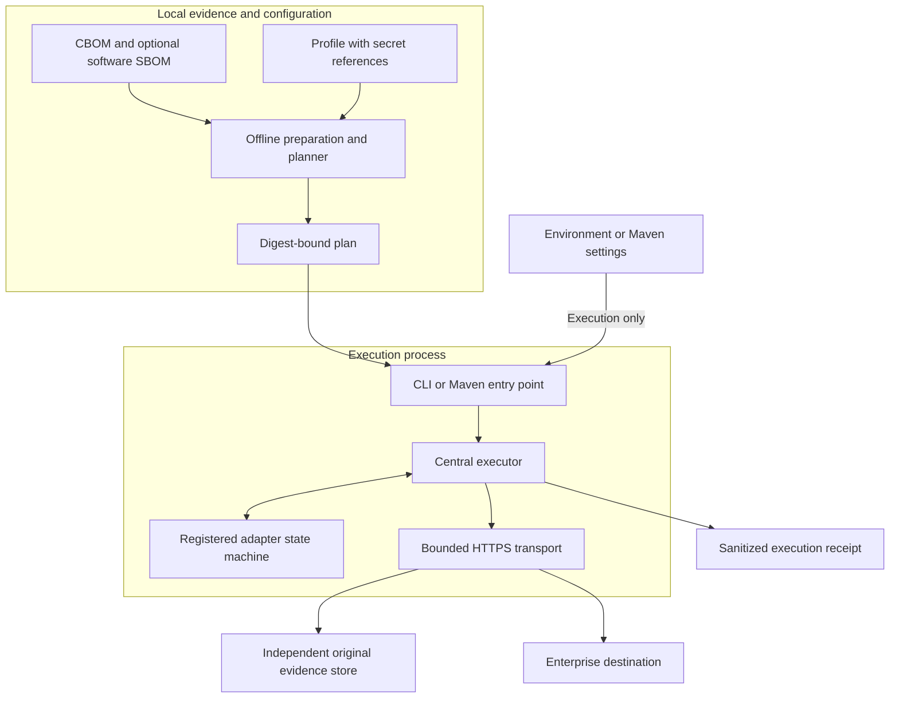
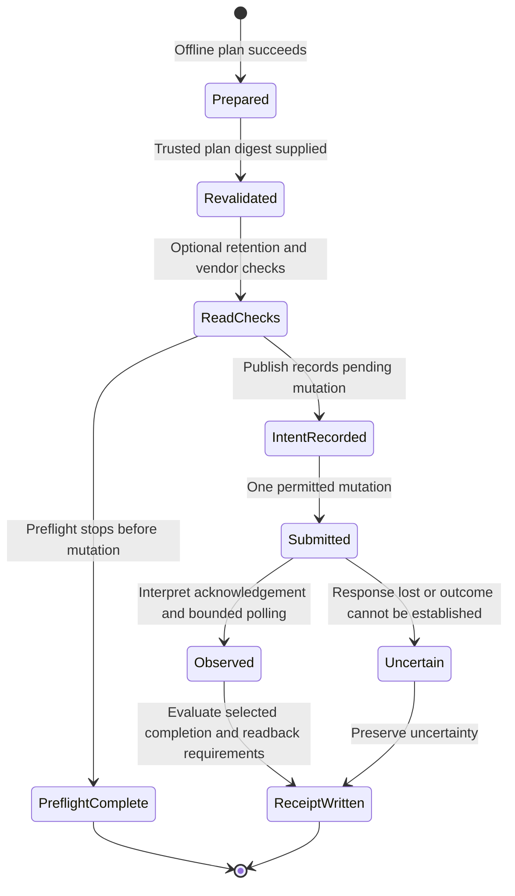

# Enterprise delivery architecture

Enterprise delivery turns a validated artifact and explicit policy into a bounded protocol execution. The same profile engine serves the CLI and Maven plugin. It preserves the distinction between original evidence, a prepared publication, remote acceptance, ingestion, and verified readback.

## Trust boundaries

The adapter receives verified publication bytes, typed options, and bounded responses. It does not receive credentials or an HTTP client. The central executor owns secret resolution boundaries, permitted requests, TLS, deadlines, response limits, mutation intent, and exact-byte readback proofs.

Adapters are registered Java implementations of `DestinationAdapter`; they are not dynamically downloaded plugins or executable profile hooks. Extending the destination set requires code, tests, declared capabilities, and registration. Profile options cannot override arbitrary headers or run shell commands.

## Plan before contacting a destination

Planning validates source digests, input kinds, preparation, capability revision, field requirements, and exact accepted loss codes. It creates prepared evidence and a sanitized plan without resolving secrets or making network requests. Keep the printed plan digest in trusted CI state.

Execution revalidates the profile, sources, preparation, capabilities, and configured CA bytes against that plan. A changed endpoint, destination mapping, input, policy, or trust bundle requires a new plan. The bound configuration identifies intent; it does not reserve a destination against concurrent writers.

This is a conceptual lifecycle, not a list of receipt enum values. Failures during any stage stop the relevant work; a persisted receipt records execution observations when execution has begun. Invalid profiles or unresolved credentials may fail before a deliverable execution outcome exists.

`preflight` performs configured read-only checks and stops before an upload. For generic HTTPS without retention readback, it makes no network request. A preflight success cannot establish that a subsequent write will succeed or prevent another client from changing inventory.

## Interpret completion precisely

| Evidence dimension | What it establishes | What it does not establish |
| --- | --- | --- |
| Upload accepted | A bounded response acknowledged the submitted request. | Completed ingestion or retained bytes. |
| Ingestion completed | The adapter observed the documented completion condition. | Preservation of every crypto field. |
| `originalRetention` | Before upload, an independent endpoint returned exact publication bytes. | Future retention, or retention of every linked source. |
| `destinationReadback` | The destination returned exact publication bytes after the relevant write. | Searchable semantic inventory or a retention SLA. |
| Declared semantic capabilities | The plan records preserved, lost, or unverified field support. | A runtime comparison unless one was actually performed. |

The executor verifies readback digests centrally and clears an earlier destination proof before a later mutation. An adapter requiring destination readback cannot report success with a missing or mismatched download, even if the server accepted the upload. Original retention and destination readback are distinct receipt fields.

`requiredFields` must be declared `PRESERVED`. Accepting a loss code cannot override that requirement, and `UNVERIFIED` does not pass it. Loss acceptance names the exact set; there is no wildcard to silently accept future loss categories.

## Destination contracts

| Destination | Implemented role | Principal limit |
| --- | --- | --- |
| [Generic HTTPS](../DELIVERY-PROFILES.md) | POST exact prepared bytes to a receiver. | Acceptance does not establish ingestion or fidelity. |
| [Dependency-Track](../DEPENDENCY-TRACK.md) | Guarded, explicitly lossy runtime project for the tested 5.2.0 contract. | Requires a dedicated owned project and independent original retention; cannot replace the software inventory. |
| [Artifactory](../ARTIFACTORY.md) | Store the publication at a scoped repository path and verify its downloaded bytes. | Experimental; does not claim Xray analysis or semantic ingestion. |
| [Sonatype SBOM Manager](../SONATYPE-SBOM-MANAGER.md) | Import into an explicitly mapped application/version, observe completion, and verify original download. | Experimental; commercial-tenant validation remains outstanding. |
| [Anchore Enterprise](../ANCHORE.md) | Submit an SBOM asset to an explicitly mapped application/version and observe the job. | Experimental; original retention is independent and crypto semantics remain unverified. |

The vendor guides specify capability revisions, authentication, permissions, mapping, loss codes, and operator assertions. In particular, a “single writer” declaration is an operator responsibility; a read-before-write check is not an atomic server-side reservation.

## Transport and failure containment

HTTPS hostname verification is mandatory. Redirects and credential-bearing URLs are rejected. Explicit CA and proxy configuration applies consistently to upload and readback. Profiles contain references to environment variables or Maven server entries, never literal tokens; paired Basic references remain distinct from bearer/API-key references.

The profile engine bounds source/readback sizes, protocol response sizes, exchange count, connection and request duration, and overall execution time. Vendor mutations are single-attempt. Generic HTTPS can use bounded retries only under its explicit receiver idempotency contract. An uncertain submission must be reconciled at the destination before an operator repeats it; Census does not claim exactly-once delivery.

Plans and receipts omit credentials, endpoint text, and remote response bodies, but still contain operational identifiers and local paths. Protect them as build evidence. See [delivery operations](../DELIVERY-OPERATIONS.md) for proxy authentication, retry restrictions, and recovery procedures.

Implementation: [DestinationAdapter](https://github.com/DevelopmentSprint/crypto-census/blob/develop/census-delivery/src/main/java/com/developmentsprint/cryptocensus/delivery/profile/DestinationAdapter.java), [ProfilePlanner](https://github.com/DevelopmentSprint/crypto-census/blob/develop/census-delivery/src/main/java/com/developmentsprint/cryptocensus/delivery/profile/ProfilePlanner.java), [ProfileExecutor](https://github.com/DevelopmentSprint/crypto-census/blob/develop/census-delivery/src/main/java/com/developmentsprint/cryptocensus/delivery/profile/ProfileExecutor.java), and [ProfileTransport](https://github.com/DevelopmentSprint/crypto-census/blob/develop/census-delivery/src/main/java/com/developmentsprint/cryptocensus/delivery/profile/ProfileTransport.java).
