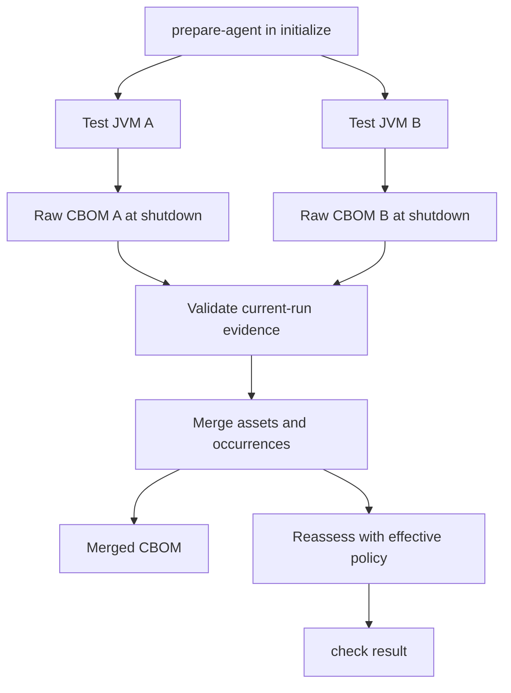
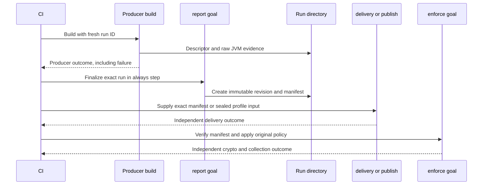
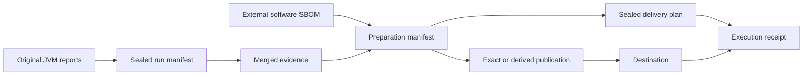

# The evidence pipeline

Census carries observations through explicit artifacts so that collection, policy, and delivery remain independently inspectable. Choose the ordinary Maven `check` flow for a single build invocation, or the run-ID-based report/enforce flow when CI must finalize evidence after a failed producer step.

## From JVM reports to a build result

`prepare-agent` creates a run directory and adds the agent argument to the configured Maven property. Forked Surefire and Failsafe processes write distinct raw reports. `check` uses the run directory registered in the current Maven project context; it does not trust a user-set “latest report” property or scan an arbitrary previous invocation.

Merging aggregates matching assets and occurrences, preserving counts and health information. Assessment uses the policy implementation rather than trusting a descriptive risk label in input JSON. The merged output records input digests so reviewers can identify the exact contributing files.

By default the user-facing merged file is `target/cryptocensus/cbom.json`. That convenient output name alone does not establish freshness. Use the run registration and manifest workflow when handing evidence between separate CI steps.

## Explicit finalization across CI steps

Provide a fresh lowercase UUID as `census.runId` for every CI attempt. The module-specific directory is `census.destDir/run-<runId>-<moduleHash>`, with an exclusively created `run.json` descriptor. The module hash derives from `groupId:artifactId`, keeping modules distinct even when they share a destination directory.

`report` writes `revisions/1/evidence.json` and `revisions/1/manifest.json`. The manifest binds the descriptor, raw input names and digests, merged output digest, effective policy/configuration, health, producer outcome, crypto outcome, and finalization time. It can record a policy failure or incomplete collection without failing the reporting step; missing or corrupt evidence still fails.

An identical finalization reuses the original revision bytes. If late JVM evidence arrives or policy changes intentionally, choose a new explicit revision. Census does not overwrite an earlier revision or select the newest one automatically. Preserve a partial revision after a crash for diagnosis and create another revision rather than editing it into validity.

`enforce` verifies the referenced evidence and policy before independently recomputing the result. A successful finalizer or upload must not erase the producer's failure status. Keep each result visible in CI, as shown in the [finalization runbook](../CI-FINALIZATION.md).

## Preparation and delivery add separate artifacts

The preparation manifest describes retained sources and any transformation. The plan binds inputs, capabilities, destination mapping, loss acceptance, and completion requirements. The receipt records what execution observed. None replaces the original collection health envelope or run manifest.

When a delivery profile uses a sealed Maven run, every action validates the exact manifest and selected merged artifact before outputs, secret resolution, or network operations. Preparation directories, plans, and receipts must stay outside the immutable run directory and must not alias protected evidence files.

## Integrity and provenance are different

SHA-256 comparisons detect changes relative to a trusted expected digest. Atomic writes prevent readers from seeing a partially replaced successful output. Exclusive creation prevents silently overwriting a prior preparation or revision. These controls do not authenticate the application or the CI runner.

Protect the workspace, preserve the selected revision and referenced originals, and use external signing or attestation when required. A run ID is a workflow identity, not a signature. A receipt is an observation of an execution, not a promise that remote bytes will remain available forever.

Implementation: [PrepareAgentMojo](https://github.com/DevelopmentSprint/crypto-census/blob/develop/census-maven-plugin/src/main/java/com/developmentsprint/cryptocensus/maven/PrepareAgentMojo.java), [RunEvidence](https://github.com/DevelopmentSprint/crypto-census/blob/develop/census-maven-plugin/src/main/java/com/developmentsprint/cryptocensus/maven/RunEvidence.java), [ReportMojo](https://github.com/DevelopmentSprint/crypto-census/blob/develop/census-maven-plugin/src/main/java/com/developmentsprint/cryptocensus/maven/ReportMojo.java), [EnforceMojo](https://github.com/DevelopmentSprint/crypto-census/blob/develop/census-maven-plugin/src/main/java/com/developmentsprint/cryptocensus/maven/EnforceMojo.java), and [Cbom](https://github.com/DevelopmentSprint/crypto-census/blob/develop/census-core/src/main/java/com/developmentsprint/cryptocensus/core/Cbom.java).
