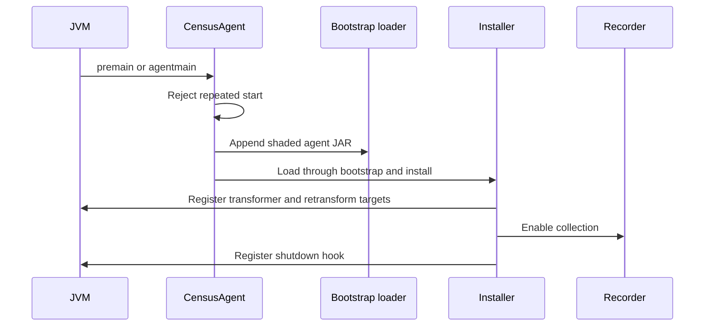
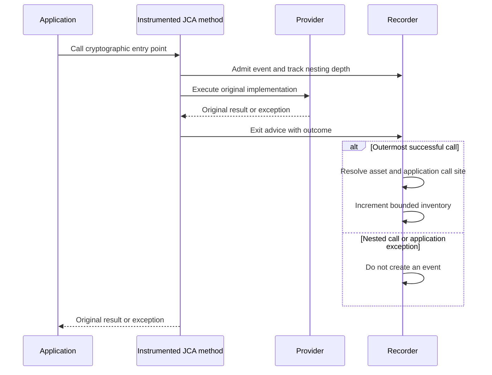
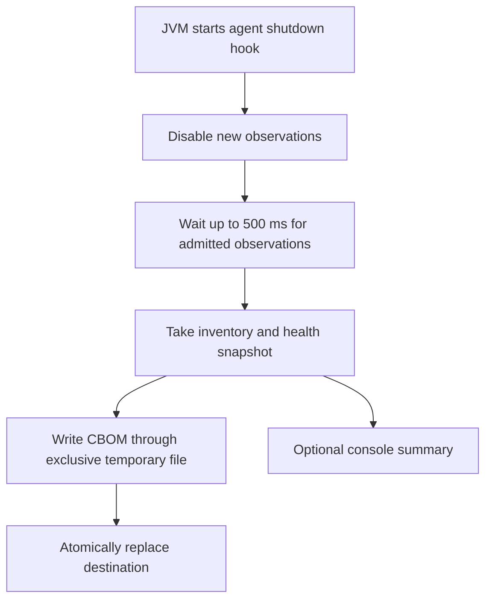

# Runtime instrumentation

The Census agent uses Java instrumentation and Byte Buddy advice to observe selected JCA/JSSE entry points. It records successful outermost calls and never replaces their arguments, return values, or application exceptions. This page explains the collection lifecycle and the limits that follow from those choices.

## Bootstrap installation

JCA classes such as `Cipher` and `Signature` load through the bootstrap class loader. Advice inserted into those classes must be able to call the recorder from that loader. `CensusAgent` therefore appends its own shaded JAR to bootstrap search before explicitly loading `Installer` there.

All agent classes, including relocated dependencies, reside under the agent namespace. The installer supplies module read edges for the recorder and disables class-format changes. If installation fails after registering a transformer, it attempts to reset the partial transformation and disables collection. Agent startup failure does not stop the application.

Prefer startup attachment with `-javaagent` when you need evidence from application initialization. Dynamic attachment only observes subsequent behavior; it cannot reconstruct earlier cryptographic calls. Consult [compatibility](../COMPATIBILITY.md) before enabling experimental support for a newer class-file version.

## Entry points and event handling

The principal targets are cipher initialization, signature initialization, MAC initialization, key agreement, KEM creation on supported JDKs, key generation, digest factories, and JSSE session construction. The [policy reference](../POLICY.md) lists their exact entry points and captured properties.

A thread-local nesting counter avoids counting overload delegation and nested JCA work twice. JSSE constructors use a separate construction guard because constructor advice has different exception constraints. Repeated constructor chaining for the same session object is suppressed.

The recorder resolves algorithm aliases through the selected provider and records the first application stack frame, using class-loader attribution rather than an application package-name prefix. It also identifies paths through JDK subsystems such as JSSE, JAR verification, PKI validation, and secure random. Provider implementation frames are skipped so findings point toward useful application context.

## Inspect keys without changing provider behavior

Key inspection uses reviewed forms and available public parameters. Third-party secret keys are not exported, and PKCS#11 keys are not inspected. For a small set of reviewed JDK secret-key classes, the agent reads an encoded copy to determine size and wipes that copy. The inventory stores descriptions and sizes, not key bytes.

Observation also avoids accessors with side effects. Calling `KeyGenerator.getProvider()` or the JDK key-pair generator delegate's equivalent can disable provider failover. Advice reads their provider field instead. These details preserve the application's choice of provider and failure behavior while collecting metadata.

## Shutdown and health

The snapshot includes recording failures, transformation failures, target status, dropped observations, and a drain-timeout count. Distinct assets and per-asset call sites are bounded. Exceeding the asset limit drops observations and makes collection incomplete; exceeding the call-site limit folds attribution into an overflow occurrence while retaining the asset and its count.

The shutdown hook defines the collection boundary. Cryptography in other shutdown hooks may run too late to appear. A forced kill can prevent all output, and a missing report cannot be repaired by reusing an earlier run. Containers should terminate gracefully and allow the JVM to finish writing.

JSSE session construction happens before handshake authentication finishes. A session can therefore be counted even if the handshake later fails. TLS protocol and cipher-suite observations do not establish the negotiated key-exchange group for that specific session; separately observed key-agreement/KEM assets are not joined into a complete handshake record.

For supported options and output budgets, use [agent operations](../OPERATIONS.md). For exclusions and performance positioning, use [safety and limitations](../SAFETY.md).

Implementation: [CensusAgent](https://github.com/DevelopmentSprint/crypto-census/blob/develop/census-agent/src/main/java/com/developmentsprint/cryptocensus/agent/CensusAgent.java), [Installer](https://github.com/DevelopmentSprint/crypto-census/blob/develop/census-agent/src/main/java/com/developmentsprint/cryptocensus/agent/Installer.java), [Advices](https://github.com/DevelopmentSprint/crypto-census/blob/develop/census-agent/src/main/java/com/developmentsprint/cryptocensus/agent/Advices.java), [Recorder](https://github.com/DevelopmentSprint/crypto-census/blob/develop/census-agent/src/main/java/com/developmentsprint/cryptocensus/agent/Recorder.java), and [KeyInfo](https://github.com/DevelopmentSprint/crypto-census/blob/develop/census-agent/src/main/java/com/developmentsprint/cryptocensus/agent/KeyInfo.java).
