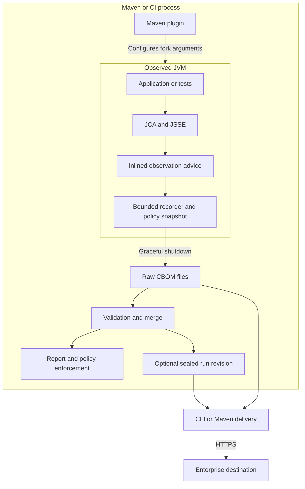
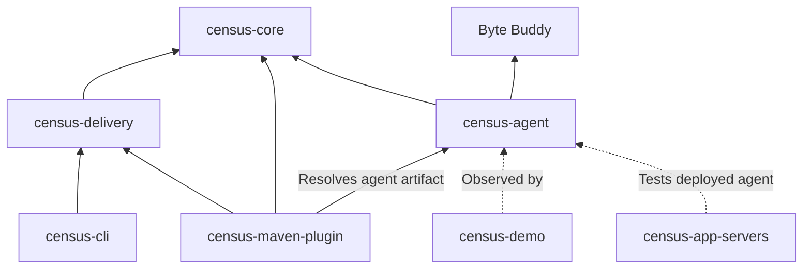

# Architecture overview

Crypto Census separates observation inside the application from evidence processing and network delivery outside it. The agent collects a bounded runtime inventory and writes a local CBOM. Maven and the CLI consume files after collection; optional delivery adapters communicate with enterprise services.

## Process boundaries

No Census service must remain running beside the application. For CI use, the test JVMs exit, Maven reads their files, and a separate step can publish the evidence. For an application-server workload, collection lasts until the agent's shutdown hook; periodic and on-demand flushing are not implemented.

## Modules and responsibilities

| Module | Responsibility | Boundary |
| --- | --- | --- |
| `census-core` | Asset model, normalization, risk policy, inventory, CBOM parsing/writing, and text reporting. | Reusable evidence logic. |
| `census-agent` | Byte Buddy instrumentation, safe parameter inspection, call-site attribution, and shutdown collection. | Runs in the observed JVM; shades core and Byte Buddy into its own namespace. |
| `census-delivery` | Input validation, software-SBOM preparation, profiles, protocol adapters, bounded transport, plans, and receipts. | Delivery-side dependencies and networking. |
| `census-cli` | Command-line access to publication and profile delivery. | Processes existing artifacts; does not attach an agent or launch tests. |
| `census-maven-plugin` | Agent setup, current-run aggregation, report/enforce lifecycle, and delivery goals. | Maven build integration. |
| `census-demo` | Small executable examples of observed cryptographic behavior. | Demonstration, not an enterprise service. |
| `census-app-servers` | Container-backed application-server integration tests under the app-server profile. | Conformance verification rather than a shipped server. |

The root parent POM supplies dependency management and build gates. The app-server module is profile-controlled; it is not part of every ordinary reactor invocation.

Solid arrows describe code/artifact dependencies relevant to the design; dotted arrows describe test usage. The Maven plugin does not embed enterprise transport into application test code. The agent remains independent of the delivery module's HTTP and JSON-schema libraries.

## Two different failure policies

Inside the JVM, observation must not make the application's cryptographic operation fail. Advice suppresses observer exceptions, startup failure leaves the application running, and collection problems are recorded where evidence can still be produced.

Outside the JVM, evidence processing fails closed when it cannot establish the required facts. The build can reject missing or malformed evidence, incomplete collection, and disallowed policy outcomes. Delivery rejects altered inputs, unknown configuration, and unmet destination requirements. An observer that fails open and a CI gate that fails closed serve different responsibilities.

## Data is the integration boundary

Raw CBOMs, merged evidence, run manifests, preparation manifests, delivery plans, and receipts are explicit files. This lets CI retain and inspect evidence without running a Census server. It also makes ownership clear: the application runner owns its output directory, the CI workflow owns freshness and artifact retention, and the delivery process owns credentials and transport.

These files contain internal names and operational identifiers. Owner-only POSIX permissions reduce accidental exposure but do not protect against the same OS user or an untrusted parent directory. See [operations](../OPERATIONS.md) and [delivery operations](../DELIVERY-OPERATIONS.md) for deployment and retention controls.

Continue with [instrumentation](instrumentation.md), [the evidence pipeline](evidence-pipeline.md), and [enterprise delivery](enterprise-delivery.md).

Implementation: [parent POM](https://github.com/DevelopmentSprint/crypto-census/blob/develop/pom.xml), [agent packaging](https://github.com/DevelopmentSprint/crypto-census/blob/develop/census-agent/pom.xml), and [delivery dependencies](https://github.com/DevelopmentSprint/crypto-census/blob/develop/census-delivery/pom.xml).
