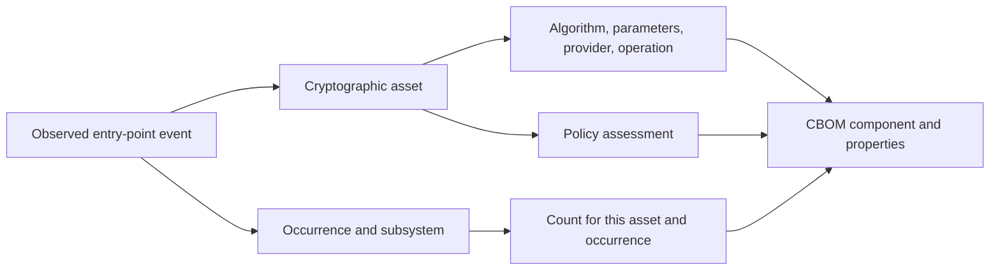
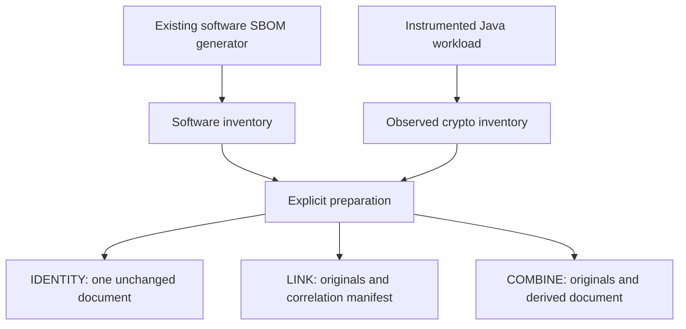

# Understand cryptographic evidence

A Census CBOM describes cryptography observed during a particular execution. It uses CycloneDX 1.6 JSON, with cryptographic components and Census properties for observations, assessment, and collection health. It is a partial view of application behavior, even when collection reports no errors.

## What is an asset?

Census groups observations by the cryptographic properties that matter to its assessment. These include the primitive, canonical algorithm, requested mode and padding, observable key size, provider, TLS protocol, and operation. The application location is tracked separately as an occurrence.

An RSA signing operation and an RSA verification operation can receive different verdicts, so the operation is part of their identity. A key size of zero represents an unobserved size, not a zero-bit key. A provider name describes the implementation that served the observed call; it does not establish ownership by a software package.

Counts represent successful observed entry-point events. One `Cipher.init` followed by a thousand `doFinal` calls counts once. Creating a message digest counts even if the application never hashes data with it. Counts are neither throughput measurements nor a measure of encrypted data volume.

## A CBOM complements a software SBOM

Continue using your software SBOM generator for packages, versions, licenses, and dependency graphs. Census supplies cryptographic usage evidence. It does not infer which dependency owns an observation merely because a package name, provider name, or call site looks similar.

Choose a preparation mode according to the receiving system and your evidence requirements:

| Mode | Result | What it does not establish |
| --- | --- | --- |
| `IDENTITY` | Validate and publish one original document without changing its bytes. | That a receiver interprets every field. |
| `LINK` | Retain a software SBOM and CBOM with a correlation manifest; publish the unchanged CBOM. | A navigable relationship inside the target UI. |
| `COMBINE` | Retain both originals and create a separately identified combined CycloneDX document. | Package attribution, transferred source signatures, or permission to replace an enterprise inventory. |

All sources in a linked or combined preparation must have exactly matching application, module, version, and run identifiers. These labels are caller assertions. Hashes bind the bytes; they do not authenticate the producer or prove that two documents came from the same trusted build.

The external software input currently accepts CycloneDX 1.6 JSON. SPDX conversion and other CycloneDX versions are outside the implemented preparation boundary. Source signatures remain in original documents, but preparation does not verify them; signatures on modified derived content are removed with an explicit loss record. See [SBOM preparation](../SBOM-PREPARATION.md) for validation and transformation details.

## Four limits to interpreting a result

**Execution coverage:** an unexecuted path is invisible. Run workloads that reach the behavior you care about, including configuration-dependent and failure paths.

**Instrumentation coverage:** an expected JDK target can be missing or uninstrumented. Read collection health and target status alongside the component list. A valid JSON document alone does not establish complete collection.

**Parameter visibility:** not every key or parameter is safely observable. HSM keys are not inspected. Census does not capture GCM tag length, OAEP parameters, or a complete TLS handshake correlation. See the full [limitations](../SAFETY.md#known-limitations).

**Trust:** code inside the JVM can suppress or forge observations, and an actor with access to the output can alter it. Archive evidence through a trusted pipeline and sign outside the observed JVM when your assurance requirements call for it.

## Preserve the original when delivering

An enterprise product accepting a document, finishing ingestion, returning identical bytes, and exposing every cryptographic field are four different outcomes. Census receipts keep those outcomes separate. A successful upload cannot upgrade incomplete collection into complete evidence or make an unobserved component quantum safe.

Keep the original CBOM, its run evidence, and the delivery plan and receipt together. Read [enterprise delivery architecture](../architecture/enterprise-delivery.md) before choosing a destination.

Implementation: [CryptoAsset](https://github.com/DevelopmentSprint/crypto-census/blob/develop/census-core/src/main/java/com/developmentsprint/cryptocensus/core/CryptoAsset.java), [Inventory](https://github.com/DevelopmentSprint/crypto-census/blob/develop/census-core/src/main/java/com/developmentsprint/cryptocensus/core/Inventory.java), and [ArtifactPreparer](https://github.com/DevelopmentSprint/crypto-census/blob/develop/census-delivery/src/main/java/com/developmentsprint/cryptocensus/delivery/preparation/ArtifactPreparer.java).
