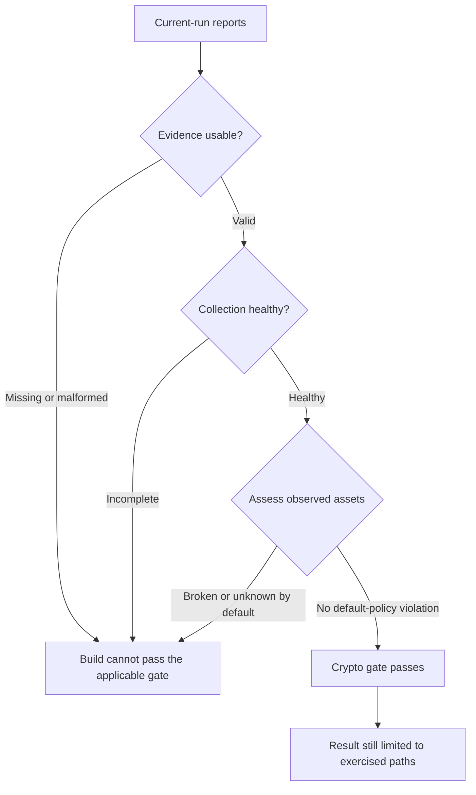
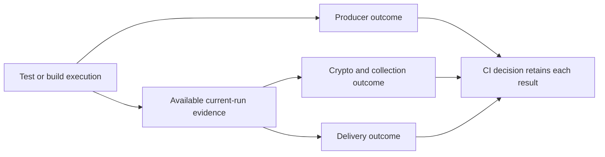

# Policy, confidence, and coverage

Census evaluates observed assets with a versioned policy and evaluates the collection separately. A useful CI result answers both “what did we observe?” and “did collection work as expected?” Neither answer proves that tests exercised every relevant application path.

## Read verdicts in context

The current policy identifier is `cryptocensus-default/6`. Its allow-lists recognize algorithms, parameters, signature key types, and TLS combinations. An unrecognized value remains `unknown`; Census does not infer safety from a plausible name.

| Verdict | Interpretation | Typical next action |
| --- | --- | --- |
| `broken` | A known prohibited or broken use under this policy. | Locate the call site and prioritize correction. |
| `weak` | Deprecated, legacy-only, or weak configuration. | Review the operation and plan a replacement. |
| `quantum-vulnerable` | Recognized classical public-key cryptography exposed to a sufficiently capable quantum computer. | Include it in the application's migration inventory. |
| `acceptable` | Accepted by the current policy without the stronger quantum-safe classification. | Retain the evidence and evaluate application-specific requirements. |
| `quantum-safe` | Classified as quantum-resistant by this policy. | Check parameters, coverage, and the required compliance profile independently. |
| `unknown` | Information is missing or the observed form is not recognized. | Investigate rather than treating it as a pass. |

`unknown` is not a severity between two known risks. When independent findings are combined, a definite `broken` result wins; otherwise an unknown finding is retained rather than hidden behind a lesser known risk. For example, an unobservable public-key size can prevent an otherwise recognizable signature from receiving a confident assessment.

`quantum-safe` does not mean CNSA 2.0 compliant. Census records `cryptocensus:cnsa2` separately. The [policy reference](../POLICY.md) defines the exact examples, operation-sensitive rules, and standards used by this version; use that reference when reviewing a finding.

## Understand the default Maven gate

The default `check` configuration uses `census.failOn=broken`, with `census.failOnUnknown`, `census.failOnMissingData`, and `census.failOnIncompleteCollection` enabled. Weak and quantum-vulnerable findings remain visible without failing that default severity threshold. Set `census.failOn=quantum-vulnerable` when your rollout is ready to gate those findings as well.

Missing fixed instrumentation targets are a separate setting: `census.failOnMissingTargets` defaults to `false`, so reported gaps warn unless you enable the stricter gate. A transformation error or dropped observation can still make collection incomplete independently of that setting. Setting `census.failOn=none` disables the severity threshold; it does not disable unknown, evidence, or collection checks.

Review narrow [exceptions](../MAVEN.md#reviewed-exceptions) against a documented application requirement. Broadly disabling collection checks makes a smaller inventory easier to misinterpret. Keep exceptions in version control so reviewers can distinguish an accepted finding from a newly introduced one.

## Separate three outcomes in CI

Tests can fail after producing valid evidence. Delivery can fail even when tests and crypto policy pass. Conversely, an upload can succeed while the evidence records a policy failure. Use independent finalization and enforcement steps to retain these distinctions; see [CI finalization](../CI-FINALIZATION.md).

## Coverage has two different meanings

The project's test-coverage badge measures how much Census implementation code its tests exercise. It is a quality signal about this repository. It says nothing about how much cryptography your application's workloads exercised.

For your application, build a workload matrix: business flow, configuration, provider, protocol, and expected test JVM. Include positive and negative scenarios where appropriate. Census can report health for evidence it receives, but one instrumented JVM cannot vouch for another execution that ran without the agent.

Implementation: [Policy](https://github.com/DevelopmentSprint/crypto-census/blob/develop/census-core/src/main/java/com/developmentsprint/cryptocensus/core/Policy.java), [Risk](https://github.com/DevelopmentSprint/crypto-census/blob/develop/census-core/src/main/java/com/developmentsprint/cryptocensus/core/Risk.java), and [CheckMojo](https://github.com/DevelopmentSprint/crypto-census/blob/develop/census-maven-plugin/src/main/java/com/developmentsprint/cryptocensus/maven/CheckMojo.java).
