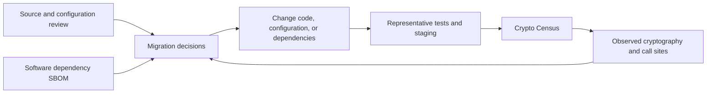
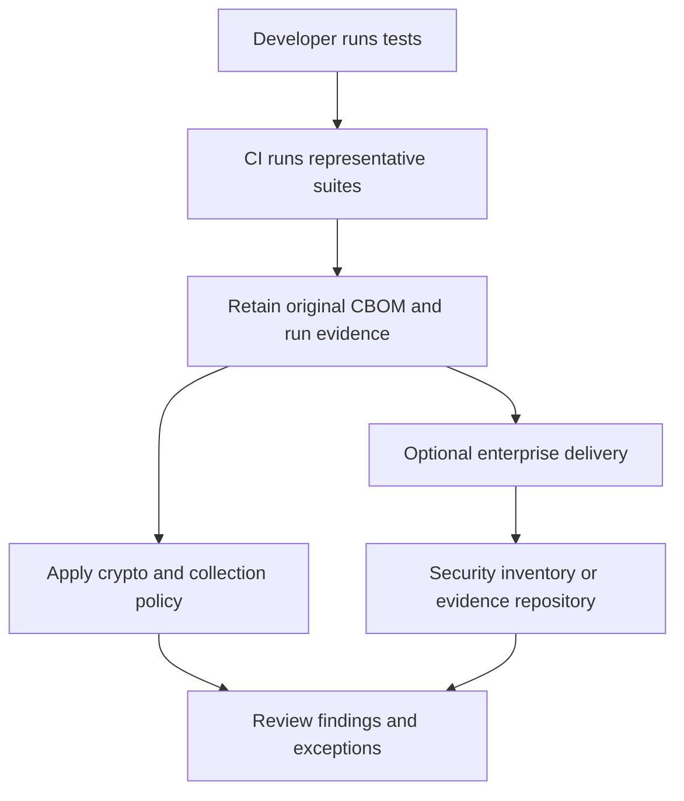

# Why Crypto Census exists

Crypto Census helps Java teams answer a practical question: **which cryptography does this application actually use, and where does it use it?** It observes cryptographic entry points while your tests or staging workloads run, records the available algorithm and parameter information, and produces a Cryptography Bill of Materials (CBOM).

A dependency inventory can tell you that a cryptographic library is present. Runtime evidence can tell you that a particular test initialized an RSA signature through a particular provider, or that a request used AES in a particular mode. These are different facts. A useful migration program retains both.

## Start with an observable migration problem

Applications often obtain cryptography indirectly through HTTP clients, certificate validation, authentication libraries, data storage, and frameworks. An algorithm name in source code does not explain which configured provider served a request or which execution path reached it. Conversely, runtime collection cannot reveal paths that the workload never exercised.

Use Census to establish a baseline, locate the application code responsible for an observation, and compare subsequent runs after a migration. Keep the workload and environment attached to that baseline: a quiet inventory from a smaller test suite is not evidence that the migration removed an algorithm.

## Three questions the tool keeps separate

| Question | Census contributes | Additional evidence you need |
| --- | --- | --- |
| What ran? | Observed JCA/JSSE entry points, available parameters, provider names, counts, and call sites. | A description of exercised workflows and expected JVMs. |
| What needs attention? | A versioned policy assessment, including current weaknesses, quantum exposure, and unknowns. | Application requirements, data lifetime, protocol context, and reviewed exceptions. |
| Can we trust the result? | Collection health, input digests, run descriptors, and delivery receipts. | A trusted CI environment, access controls, and external signing if required. |

The policy covers established cryptographic weaknesses as well as quantum migration. The distinction matters: a known broken algorithm calls for a different response from a recognized classical public-key algorithm that needs a post-quantum migration plan. Missing information is separately visible as `unknown`.

## Fit into an existing development workflow

The Maven plugin is the usual starting point for a Maven application. It attaches the agent to forked test JVMs and checks their reports during the build. A standalone `-javaagent` configuration supports other launchers and application servers. The delivery CLI and Maven delivery goal run after evidence collection; you do not need an application server to upload an existing CBOM.

Collection works locally without a Census server, account, or paid service. Enterprise delivery is optional. The agent itself does not contain the delivery transport or enterprise credentials.

## Know the current boundary

Census targets tests and staging today; runtime overhead has not been benchmarked. It observes supported JCA/JSSE paths, not every cryptographic implementation. Native libraries and Bouncy Castle's lightweight API can bypass those paths. Evidence remains self-reported because collection runs inside the observed JVM.

Follow [installation](../INSTALLATION.md) to set up Census and [compatibility](../COMPATIBILITY.md) for tested runtimes.

Continue with [cryptographic evidence](cryptographic-evidence.md), [policy and coverage](policy-and-coverage.md), or the [architecture overview](../architecture/overview.md). The detailed behavioral contract is in [safety and limitations](../SAFETY.md).
