# Delivery profiles and adapter contracts

Design extension for `census-6dt.1`, 2026-10-10. **Approved and implemented in the uncommitted enterprise candidate, with the limits below.** The original exact-byte `publish` command remains compatible. Profiles, preparation and the guarded Dependency-Track runtime view now use a separate versioned engine. See [the executable operator guide](../DELIVERY-PROFILES.md) for current JSON fields and commands.

This document retains the broader design contract. The schematic API below describes responsibilities, not literal released Java signatures. Current `DestinationAdapter` sessions emit typed protocol requests through central transport; there is no credential handle exposed to adapters. Current profiles support explicit project UUIDs and bounded ASCII correlation, identity/link/combine preparation, exact named loss acceptance, offline sealed plans, read-only preflight and staged receipts. LINK writes a correlation manifest and publishes the CBOM; it does not establish a target UI join. Remote exact-byte proof covers the publication CBOM only. Separate original retention for combined documents, configurable retries, authenticated proxies, endpoint templates, source-revision/environment mapping, runtime semantic inventory comparison and report/enforce lifecycle changes remain future work. Dependency-Track's measured loss is not full-fidelity acceptance.

## Product boundary

Census owns runtime cryptographic observations, post-quantum assessments, occurrence evidence and collection health. Existing generators own software inventory, versions, licenses and dependency graphs. An integration may consume that external SBOM, correlate it with Census evidence, and produce a derived document or linkage manifest. It must never present Census as the software inventory's generator or infer dependency ownership from a crypto algorithm name.

Users choose a named delivery profile: artifact preparation, destination adapter, project mapping, fidelity requirements and completion requirements. The same versioned profile file and shared planner drive Maven and CLI. Keep a small typed adapter SPI and a few built-in preparation modes; no executable hooks, scripts, general expression language, automatic classpath scanning or plugin marketplace. Adapters are explicitly registered, reviewed modules bundled with a distribution. A supported third-party loading mechanism requires a later compatibility and trust design.

## Input kinds and validation

Declare the input kind; verify it against its bytes. A label never selects a weaker validator. Every source has an explicit path, expected SHA-256, producer identity when available and declared build/module correlation. Read bounded bytes once, validate and hash those same bytes. Unknown schema versions, duplicate object keys, invalid references and contradictory kind declarations fail before any destination request.

| Input kind | Required validation | Permitted role |
|---|---|---|
| `CENSUS_RAW_CBOM` | Existing strict crypto component semantics plus agent schema/health envelope. | Primary runtime evidence. |
| `CENSUS_MERGED_CBOM` | Strict crypto semantics plus merged project/input-digest and collection-health envelope. | Primary runtime evidence; do not invent absent agent-only health fields. |
| `EXTERNAL_SOFTWARE_SBOM` | A separate, bounded, offline schema validator; initially CycloneDX 1.6 JSON only, with component/reference integrity and provenance checks. No Census health envelope required or fabricated. | External source for linking/composition, or explicit adapter-supported exact-byte forwarding within a delivery profile. It is never scanned or regenerated as a software inventory by Census. |
| `DERIVED_COMBINED_BOM` | Explicit compatible CycloneDX schema, uniqueness/reference integrity, source digests and validated transformation manifest. Require the software and crypto evidence sections appropriate to the declared preparation. | An independently identified output produced by the composition step. Never routed through the strict Census-only validator. |

Schema validation loads only pinned local schemas, never remote references. Set explicit size, depth, component and aggregate input limits before accepting external BOMs; the foundation's 16 MiB per-artifact cap remains the starting bound, not an implied promise to handle every enterprise SBOM. Unsupported SPDX or CycloneDX versions produce `INPUT_SCHEMA_UNSUPPORTED`; conversion is a separately declared transformation, not an implicit fallback. Signed source bytes remain untouched; source signatures do not sign derived content.

## Preparation is separate from delivery

The shared pipeline is:

```mermaid
flowchart LR
  Inputs[Immutable CBOM and external SBOM] --> Validate[Kind and schema validation]
  Validate --> Prepare[Identity, link or combine]
  Prepare --> Bundle[Prepared artifacts and transformation manifest]
  Bundle --> Plan[Capability and policy preflight]
  Plan --> Adapter[Vendor request and response adapter]
  Adapter --> Transport[Bounded HTTPS transport]
  Transport --> Evidence[Upload, ingestion and retention evidence]
```



The preparer is pure local work with no credentials or network access. It produces an immutable `PreparedBundle`, not a vendor request. Preparation modes are a closed set:

- `IDENTITY`: retain and deliver the original bytes. No mutation of metadata to satisfy a target.
- `LINK`: retain separate source documents and write a correlation manifest; optionally create a new linking document using verified BOM-Link support. BOM-Link identifiers alone do not establish retrieval, authorization or target UI support.
- `COMBINE`: preserve the external software nodes and graph, add crypto nodes and only evidence-supported relationships, and emit a new derived BOM. Record every reference rewrite and transformation. Never rename algorithms or disguise crypto nodes as libraries to evade receiver deduplication.

A vendor adapter handles native endpoint paths, request framing, authentication scheme, project lookup, upload response, bounded polling and readback interpretation. It cannot silently modify the prepared artifact, invent ownership, loosen validation or bypass central transport/security policy. If a vendor needs content changes, it declares a named preparer with its own version and loss report; that output becomes a separately hashed artifact before delivery.

## Typed, versioned SPI

Proposed Java contract, schematic rather than released API:

```java
interface DestinationAdapter<O extends AdapterOptions> {
    AdapterDescriptor descriptor();
    CapabilityDeclaration capabilities(ServerIdentity server);
    PlannedOperation plan(PreparedBundle bundle, DeliveryMapping mapping,
                          O options, CapabilityDeclaration capabilities);
    UploadRequest uploadRequest(ApprovedPlan plan, CredentialHandle credential);
    UploadAcknowledgment interpretUpload(BoundedResponse response);
    Optional<StatusRequest> statusRequest(RemoteOperation operation);
    IngestionObservation interpretStatus(BoundedResponse response);
    Optional<ReadbackRequest> readbackRequest(RemoteArtifact artifact);
    RetentionObservation interpretReadback(BoundedResponse response,
                                          ArtifactIdentity expected);
}
```

The engine, not the adapter, executes requests, authenticates only approved origins, enforces budgets, persists intent, coordinates polling/retries and writes receipts. The credential handle is opaque outside execution; plans and string representations never expose credentials. Requests are immutable, bounded typed values; a status or readback URL from a response is accepted only after origin/path validation against the adapter contract. Adapters cannot request arbitrary outbound destinations.

`AdapterDescriptor` carries stable adapter ID, implementation version, SPI major/minor, supported profile schema and typed options schema. Initial contract identifiers are `census.adapter/1`, `census.delivery-profile/1`, `census.preparation/1`, `census.delivery-plan/1` and a new `census.delivery-receipt/2`. Unknown major versions, adapter options and incompatible capabilities fail closed. Profile input validation rejects unknown fields to catch configuration mistakes; receipt readers may ignore additive fields under a supported major version. The current receipt `/1` remains readable and is not relabeled as richer evidence. Keep proposed API names out of executable examples until implementation lands.

### Capability declaration

A declaration is tied to adapter implementation, tested server product/version range and evidence revision. An untested server version is `UNVERIFIED`, not a match by optimistic major version. It describes these independent axes:

| Axis | Required declaration |
|---|---|
| Input | Accepted input kinds, media types, schema versions and upload-size limits. |
| Semantic fields | For crypto types, cryptoProperties, operation identity, occurrences, software nodes/graph, metadata health/policy/provenance and signatures: `PRESERVED`, `TRANSFORMED`, `DROPPED` or `UNVERIFIED`, with exact tested scope and evidence. |
| Byte retention | `NONE`, `TEMPORARY`, `DURABLE_RETRIEVABLE` or `UNVERIFIED`; retrieval method and hash verification. HTTP acceptance and generated exports cannot establish exact-byte retention. |
| Inventory mutation | `REPLACE_SNAPSHOT`, `APPEND`, `MERGE_BY_KEY`, `ARTIFACT_ONLY` or `UNVERIFIED`; identity/dedup keys, ownership scope and removal behavior. Append/merge require explicit stale-component handling. |
| Completion | Synchronous versus token-based asynchronous completion, known terminal states, polling bounds and expiry behavior. Missing/unknown status is unverified. |
| Idempotency | `NONE`, `NATIVE_KEY` or `VERIFIED_EQUIVALENT`, with key scope, lifetime and conflict behavior. Repeated import acceptance is not idempotency. |
| Linkage | Whether target resolves separate BOMs or merely stores an external reference; reference visibility and access constraints must be tested. |

Keep byte preservation, semantic preservation and inventory replacement separate. A target can accept original bytes yet discard fields and replace unrelated inventory. Local originals remain required regardless of the destination declaration.

## Mapping and attribution

`DeliveryMapping` contains stable application ID, module ID, version, build/run ID, optional source revision/environment and explicit native project ID. Display names remain labels. Maven may supply its existing module/version defaults; the resolved mapping must match CLI output for the same values. Never create a project from a display name without an explicit creation policy. For multi-module projects use distinct mappings or a deliberately configured aggregate with all source modules in its manifest.

An external software SBOM and CBOM join requires explicit matching application/module/build identities plus input hashes. Missing or conflicting correlation fails unless the operator records a specific manual correlation decision and its basis; do not infer freshness from filenames or timestamps. A caller's assertion is not authenticated provenance.

Occurrence-to-package attribution is a separate optional evidence layer. Record `VERIFIED`, `AMBIGUOUS` or `UNRESOLVED`, and separate the requesting caller from the implementing provider. Package coordinates and exact version/qualifiers identify candidates; runtime artifact hashes or class-to-artifact evidence establish stronger relationships. Shaded JARs, duplicate/relocated classes, JDK modules and native providers must not be guessed from class/package names. Unresolved occurrences remain in the CBOM and manifest without fabricated dependency edges. An unobserved dependency is not thereby quantum safe.

Composition assigns deterministic noncolliding references scoped to source BOM identity, rewrites every affected reference, and checks the full graph for dangling references. Preserve software graph semantics and distinct crypto operations. Record source-reference → derived-reference mappings and counts. This does not claim complete attribution or runtime coverage.

## Profiles and controlled configuration

One versioned JSON profile specifies `adapter`, `preparation`, declared `inputs`, `mapping`, typed `adapterOptions`, `authentication`, `transport`, `policy` and `outputs`. The initial profile names are examples of intended behavior, not implemented flags:

| Profile | Preparation and destination policy |
|---|---|
| `generic-cbom-evidence` | Identity CBOM to an owned HTTPS receiver; HTTP acceptance suffices only when explicitly chosen. Remote retention/ingestion stay unverified unless receiver contract adds evidence. Maps existing foundation behavior. |
| `linked-runtime-evidence` | Keep SBOM and CBOM separate with a manifest; upload exact CBOM to an evidence store. Any vendor project reference is a separate explicitly supported metadata operation, never a crypto-only replacement of software inventory. |
| `dependency-track-runtime-view` | Optional lossy inventory view in a separately owned, explicitly provisioned project UUID, plus durable original evidence and external correlation. Requires explicit accepted loss codes and dedicated project replacement policy. Not enabled by selecting the adapter alone. |
| `combined-inventory` | Validated combined document from an external software SBOM and Census CBOM; replace only an explicitly owned complete snapshot. Requires verified receiver behavior, concurrency control and accepted field limitations. Not a workaround for DT field loss. |

Typed `DependencyTrackOptions` initially uses an explicit project UUID and an enum for owned-project snapshot replacement; creation is disabled. Separate typed `GenericHttpsOptions` allows the configured exact endpoint and approved nonsecret extension headers. No universal `Map<String,Object>` escape hatch. Unknown options fail with safe field names and corrective messages.

Endpoint templates, if needed, are adapter-owned relative paths with a finite set of typed, percent-encoded path segments such as project UUID. User input cannot change scheme, host, port, path structure or query. The operator provides one validated HTTPS base URI; endpoint/response URLs never come from BOM content. Query parameters, if a vendor readback API requires them, are generated from adapter-defined nonsecret typed values only. Foundation's arbitrary-query rejection remains unchanged. A returned token is never treated as a URL.

Custom headers are permitted only for the generic adapter under an explicit allowlist of nonsecret integration metadata. Reject control characters and reserved transport/auth headers (`Authorization`, `Proxy-Authorization`, `Host`, `Content-Length`, `Transfer-Encoding`, `Connection`, `Cookie`) plus protected Census identity headers. Vendor authentication headers such as `X-Api-Key` are populated only by the adapter from a secret reference, never through custom headers. Header names and values have bounds and stay absent from receipts unless individually declared nonsecret.

Secret references are typed environment names or Maven server IDs resolved by the calling surface. Profiles contain no literal secrets. CLI rejects Maven-only references unless a supported resolver is explicitly provided; shared profile validation and final plans otherwise match. No arbitrary auth plugin execution. Transport retains TLS certificate/hostname checks, no redirects, explicit proxy/CA configuration, bounded requests/responses/total polling, and no global JVM authentication changes. Profiles cannot weaken those invariants.

## Plans, transformations and receipts

Local preflight/dry-run validates sources, prepares artifacts in a new output directory, validates the profile, evaluates known capabilities and emits a sanitized plan with **no network requests and no secret resolution**. It must report server/project facts as unverified if not established. An optional separately named remote preflight may perform bounded authenticated read-only capability/project checks; it never uploads, creates a project or mutates metadata. A local plan is not proof of remote permissions or target state.

The plan records artifact digests/kinds, source and destination logical IDs, adapter/capability versions, preparation manifest digest, expected mutation scope, affected project, expected losses, unresolved attribution counts, completion requirements and request/polling bounds. Omit secret references' values, full endpoint URLs and raw response data. Use a destination ID and endpoint hash. Include a plan digest in execution intent and receipt; changes to artifacts, mapping, preparation, capabilities or policy invalidate the plan. The plan digest is an integrity check, not a signature or proof of approval.

Default fidelity policy rejects unsupported kinds, `DROPPED`, unaccepted `TRANSFORMED`, and `UNVERIFIED` required fields. A limited profile must explicitly enumerate accepted loss codes tied to a capability evidence revision; there is no catch-all `allowLoss=true`. Changed capabilities or newly observed losses fail closed. A config can never waive malformed evidence, TLS validation, unsafe project replacement or unresolved transport ambiguity. Required exact remote retention must fail if retrieval/byte equality cannot be demonstrated; retaining locally is not remote retention.

A preparation manifest records its schema and preparer version, all source digests/kinds/producer IDs, source build correlation, output digests and new document identities, reference rewrites, emitted/unmatched/ambiguous counts, transformations and known loss codes. Preserve original Census health and policy evidence with its source reference and digest. Record observed server losses separately from local transformations. Do not transfer signatures to modified bytes. Inputs, derived output, plan, manifest and receipts are immutable evidence objects; emit new revision filenames instead of replacing a sealed set. Dynamic intent/final status remains a separate atomic record referencing those objects.

Receipt `/2` reports independent states rather than one ambiguous success flag:

- `upload`: not attempted, accepted, rejected or unknown; safe HTTP status and remote operation token/ID, when the contract says it is nonsecret.
- `ingestion`: not applicable, pending, completed, failed or unverified; bounded observations and explicit terminal status. Completion does not imply fidelity or that all analysis jobs finished.
- `originalRetention`: local persistence evidence separately from remote unverified/temporary/verified retrieval, including retrieved digest and verification timestamp where available. A successful readback proves retrieval at that time, not indefinite retention.
- `semanticFidelity`: compared field coverage, declared and observed losses, readback artifact digest, capability evidence revision and unresolved checks.
- `inventoryMutation`: intended operation/project/ownership, precondition and before/after counts when actually observed; no inferred additive behavior.

Also record input/output/manifest/plan digests, adapter/server/profile versions, mapping, test/health/policy references, effective requested completion gate, start/finish times, attempts and deadlines. Gate success depends on explicit profile requirements, never on relabeling an unknown state. Durable exact evidence storage and a lossy inventory submission are distinct operations with separate receipts; partial success remains visible and never rolls back or deletes an original artifact. Poll timeout leaves ingestion unverified/pending and does not retry the upload automatically.

## Dependency-Track guardrails

The local 5.2.0 experiment completed imports but reduced seven Census assets to five, dropped standard cryptoProperties and original metadata health/policy/provenance, and deleted every seeded software component when a crypto-only BOM replaced its project's inventory. Reversing the upload removed crypto inventory. Generated exports do not retain original bytes; temporary upload storage is removed after processing. These findings are recorded in the separate `DEPENDENCY-TRACK-FIDELITY.md` experiment artifact and are stronger evidence than CycloneDX upload support alone.

Consequently the DT adapter must reject crypto-only publication into an existing software-inventory project. A runtime view requires a separately owned project UUID, explicit replace-snapshot policy and durable exact evidence elsewhere. A sidecar correlation manifest may link to the software project, but do not claim DT resolves BOM-Link or displays that relationship without testing it. Dedicated ownership requires an explicit provisioned mapping and verification; an empty current inventory is not proof of ownership.

An approved combined snapshot must include the external software inventory and account for all intended project contents. Require a single designated snapshot writer or an enforced lease/version precondition; a preflight read alone does not prevent a concurrent upload. Without a verifiable concurrency/ownership mechanism, refuse shared-project replacement. Even a correct combined upload must disclose DT's measured crypto losses; it does not meet a full-fidelity requirement. A production DT adapter cannot be enabled until the operator chooses and configures an explicit limited profile and its loss policy. User selection of DT alone is insufficient.

For 5.2 polling, require token status `COMPLETED`; `processing=false` with absent status is unverified. Preserve failure and unknown/expired tokens distinctly. Default to no upload retry: the experiment established no native idempotency. Product/version and capability evidence must be in the plan/receipt. Do not fabricate software components, rename crypto algorithms or silently deduplicate to satisfy DT identity rules.

## Acceptance and implementation slices

1. Profile/SPI validation and planning: malformed/wrong-kind input, unsupported schema, unknown options, source/profile mutation, unsafe templates/headers, secret diagnostics and network-free dry-run tests. CLI/Maven produce equivalent sanitized plans and gates.
2. Preparation/linking: preserve originals and external software graph, deterministic reference rewrites, no dangling references, signed-source preservation, mismatched build rejection, explicit manual correlation and unresolved ownership. Separate derived-document validator; no loosening of Census-only validation.
3. Capability/mutation enforcement: receiver contracts cover software A → crypto B → software A, removal behavior, deduplication, async unknown tokens, idempotency conflicts and exact-byte readback. Unknown capability versions and unaccepted losses block before mutation.
4. DT limited-profile acceptance: separately owned project guard, refusal to replace software inventory with CBOM, explicit loss manifest, bounded COMPLETED polling, immutable external original evidence and safe token/auth handling. Combined snapshot requires its own graph/fidelity/concurrency tests; not a default shortcut.
5. End-to-end lifecycle and operator documentation: passing and failed-build runs, independent test/policy/delivery gates, partial destination failures, retained evidence and audit receipts across both entry points. No tests claim source authenticity or complete runtime coverage from a caller-supplied hash.

Implementation tracking: `census-6dt.8` owns profiles/SPI/planning and staged receipts; `census-6dt.9` owns input validation and local linking/composition, depending on the profile contract. Existing `.4` lifecycle, `.5` vendor and `.6` operational work remain separately required.

This contract is ready for review before implementation. The existing generic foundation can be accepted independently; profile parsing, external-SBOM validation, preparation, public SPI compatibility, DT submission and receipt `/2` remain proposed work.
