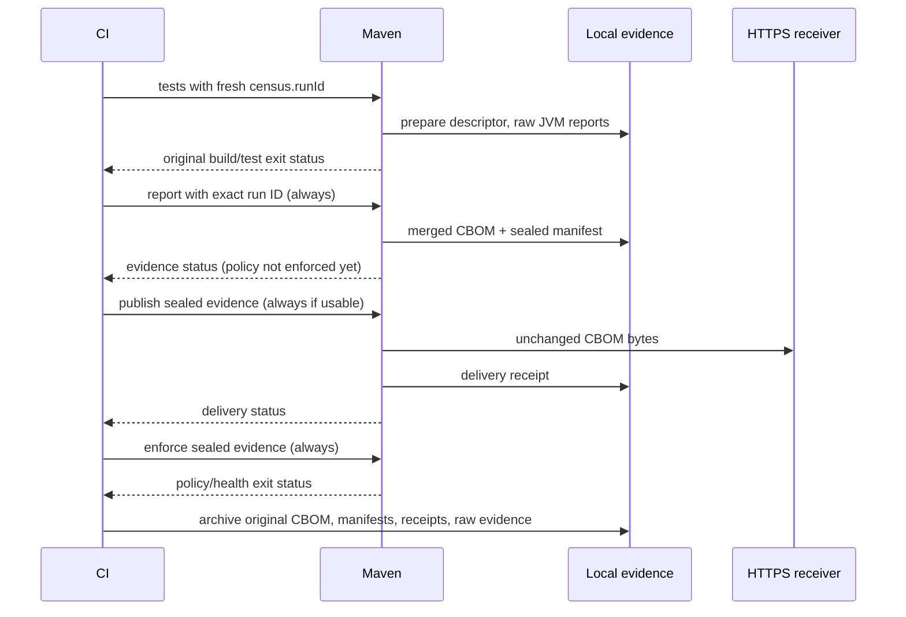

# Enterprise CBOM delivery

Design task: `census-6dt.1`; parent epic: `census-6dt`.
Status: foundation contract accepted by coordinator on 2026-10-10; implementation tested and awaiting acceptance/integration. The subsequent adapter/profile contract is proposed for review, with no implementation changes. Later milestones remain separately tracked.
Baseline: release candidate `e909943d34baba3ef0c520b32704e04e1f978401`.

## Outcome and milestones

Publish the exact runtime CBOM produced by Crypto Census from Maven or a standalone command, retaining local evidence and a clear delivery result. The agent keeps collecting locally. No networking, credentials, delivery dependencies, or retry work enter the instrumented JVM.

The first milestone is an HTTPS delivery foundation with a documented receiver contract. It is useful for a company's ingestion gateway or evidence store; it is not advertised as integration with an arbitrary security product. The second milestone adds reliable failed-build finalization and a verified vendor adapter. The epic remains open until its vendor, lifecycle, operational-security, and executable-documentation acceptance criteria pass.

CI is the primary workflow. Integration/staging workloads complement tests; production collection remains optional future work because the current agent emits only at graceful shutdown and overhead is unbenchmarked. A test client does not instrument the separate application server it calls. This runtime CBOM is not a software dependency SBOM.

## Proposed integration extension

The user clarified that Census supplies crypto and post-quantum evidence while existing tools own software inventories. The [delivery profiles and typed adapter contract](DELIVERY-PROFILES.md) defines distinct input kinds, separate identity/link/combine preparation, versioned destination capabilities, explicit project ownership/mutation policy, safe configuration, sanitized preflight and staged receipts. It is proposed work, not behavior of the current generic publisher. The strict Census CBOM validator remains unchanged and must not accept arbitrary software or combined documents.

## Verified destination assessment

Checked against official release/source information on 2026-10-10, not inferred from generic CycloneDX upload support:

| Target | Verified behavior | Decision |
|---|---|---|
| Dependency-Track 5.2.0 (selected by user) | Local import/export experiment completed successfully yet reduced seven crypto assets to five, omitted all standard cryptoProperties and original health/policy/provenance metadata, and replaced all pre-existing software components on a crypto-only upload. Generated exports are not retained originals. | Selected vendor with measured limitations. Reject crypto-only replacement of software inventory. A proposed separate owned runtime view or verified combined snapshot needs an explicit limited profile, preserved original evidence and accepted loss policy; vendor selection alone does not authorize loss. |
| HTTPS receiver contract below | Our client can send the original bytes and distinguish HTTP acknowledgment from semantic ingestion. Destination retention/query behavior belongs to its operator. | First foundation adapter; explicit destination configuration required. |
| Other enterprise vendors | A separately tracked landscape review compares adoption evidence and CBOM fidelity. | Supplemental research; Dependency-Track remains the selected first vendor. |

Dependency-Track's official latest release is [5.2.0](https://github.com/DependencyTrack/dependency-track/releases/tag/5.2.0). The evidence is its pinned [classifier](https://github.com/DependencyTrack/dependency-track/blob/5.2.0/apiserver/src/main/java/org/dependencytrack/model/Classifier.java), [converter](https://github.com/DependencyTrack/dependency-track/blob/5.2.0/apiserver/src/main/java/org/dependencytrack/parser/cyclonedx/util/ModelConverter.java), and [component model](https://github.com/DependencyTrack/dependency-track/blob/5.2.0/apiserver/src/main/java/org/dependencytrack/model/Component.java). Its [cryptographic asset feature issue](https://github.com/DependencyTrack/dependency-track/issues/3145) remains open. A later isolated 5.2.0 experiment verified the losses and snapshot replacement behavior described above; its detailed evidence is in the separate `DEPENDENCY-TRACK-FIDELITY.md` experiment artifact, pending integration. The experiment also verified token status `COMPLETED`; `processing=false` alone did not establish completion. The old [CI documentation](https://docs.dependencytrack.org/usage/cicd/) describes upload and project mapping but does not establish CBOM fidelity.

Every supported adapter smoke test uploads our real CBOM, then reads the destination's inventory/export and compares asset types, algorithm/protocol properties, occurrences, custom policy/health properties, and provenance. API acceptance alone cannot pass that test. No conversion to fake software-library components is permitted. A future lossy adapter needs explicit product approval, a transformation receipt, preserved original evidence, and a visibly different fidelity claim.

## Foundation implementation boundary

Add `census-delivery`, Java 17, depending on `census-core`. Maven and a separate executable `census-cli` depend on delivery. The agent and core have no delivery dependency. Use JDK `HttpClient`; avoid a framework, background daemon, third-party adapter discovery, and dynamic code loading.

Package: `com.developmentsprint.cryptocensus.delivery`. The foundation contract has these responsibilities:

| Type | Responsibility |
|---|---|
| `DeliveryRequest` | Explicit source `Path`, expected SHA-256, source run ID, destination ID/URI, application, module, version, receipt `Path`, and typed transport settings. No destination or credentials read from the CBOM. |
| `DeliveryEngine` | Read once with `Cbom.readBytes`, strictly parse those same bytes with `Cbom.parseEvidence` and validate the Census health envelope, verify expected digest, call the selected adapter, then persist a receipt. Bad input produces no request. |
| `DeliveryAdapter` | Internal interface for preparing a request and interpreting its response using shared bounded transport. The built-in `GenericHttpsAdapter` is the only foundation implementation. Adapters cannot introduce unbounded retry loops. |
| `DeliveryCredentials` | Execution-scoped resolved authentication, with redacted string representation; never part of request metadata or receipt serialization. |
| `DeliveryReceipt` | Safe outcome returned by the engine and written as a versioned nonsecret record with identity, effective bounds, attempt count, and recording timestamp. Gate policy belongs to the calling Maven/CLI surface. |

Artifact bytes remain immutable within the engine (no exposed mutable array) and are sent exactly as read. Do not regenerate CycloneDX: doing so changes its serial number and hash. Preserve the existing reader's 16 MiB cap and strict parser limits. Health can be incomplete yet structurally valid: delivery of that evidence is allowed. The foundation receipt points to `ORIGINAL_ARTIFACT` for health evidence and does not claim health completeness; interpreted health/test/policy outcomes arrive with lifecycle finalization. Malformed or missing evidence never becomes an empty successful upload.

Foundation provenance is explicitly **caller supplied**: the caller must provide both expected digest and run ID, but these values do not establish when the artifact was collected. Retrying an existing artifact is intentional. Do not advertise automatic current-build provenance until the manifest milestone lands. CI can calculate the expected digest only after collection and retain it as an output of that producing step; a later uploader must not silently invent a new expected value.

Require a destination ID matching `[A-Za-z0-9._-]{1,128}`. Application, module, version, and run ID each contain 1–256 printable ASCII characters without whitespace. Source revision/environment fields are deferred. Reject receipt/source aliasing and existing symlink/nonregular input. Output directories remain a trusted boundary; create private temporary receipt files, atomically replace the destination, and inherit Windows ACLs just as the CBOM writer does. Receipt failures fail the command even after remote acceptance; throw a safe `ReceiptWriteException` with `remoteAccepted()` indicating remote acceptance, without retrying the upload. The CLI exits 5.

## HTTPS receiver contract

The foundation adapter sends `POST` to the operator's exact HTTPS URI. No URL template expansion, provider autodetection, discovery endpoint, query parameters, URL credentials, fragments, redirects, or local HTTP exception is supported. Private enterprise hosts are allowed; choosing a destination is a trusted operator action. Reject malformed and non-HTTPS URIs before opening a socket.

Request body is the original CBOM. Headers:

- `Content-Type: application/vnd.cyclonedx+json` and `Accept: application/json`.
- `X-Census-Artifact-Sha256`, the lowercase hex digest.
- `X-Census-Run-Id`, `X-Census-Application`, `X-Census-Module`, and `X-Census-Version`, the declared mapping values restricted to 1–256 printable ASCII characters without whitespace. They are sent directly, without percent-encoding. Unicode metadata is deferred.
- `Authorization: Bearer …` only when bearer authentication is configured. No arbitrary authentication/header-name feature in the initial adapter.
- `X-Census-Delivery-Id`, the deterministic submission identity. This is informational; foundation does not claim server deduplication or send `Idempotency-Key`.

A 2xx response means `HTTP_ACCEPTED`, including 202. It never means indexed, analyzed, or fully preserved remotely. Do not parse arbitrary success bodies into stronger claims. A non-JSON 2xx body is valid; malformed response means broken HTTP framing, not a JSON validation failure. 3xx is `REJECTED` and never followed. 4xx is `REJECTED`; authentication errors never retry. 5xx is `UNKNOWN` because a remote system may have accepted before failing its response. Timeouts, lost connections after transmission might start, and malformed HTTP framing/oversized responses are `UNKNOWN`; a proven elapsed deadline before send is `FAILED`. Local validation/configuration failures throw safe errors before network work. The foundation conservatively reports network/TLS failures as `UNKNOWN` with a specific safe reason code; it does not infer delivery safety from exception types. All outcomes retain evidence.

Foundation makes at most one network attempt, with no retry/idempotency option. The following retry contract is reserved for a later milestone and is not advertised by the foundation CLI/plugin: an explicit `receiverSupportsIdempotency=true` permits at most three total attempts for 408/429/500/502/503/504 or ambiguous transport errors. Never infer deduplication support from HTTP method or a successful prior request. Identity is SHA-256 over a versioned, length-delimited encoding of normalized destination URI, destination ID, application, module, version, run ID, and artifact SHA-256. No credentials participate. Same artifact in a different run is a different submission; retrying the same run uses the same key. No exactly-once guarantee exists without receiver-side persistence and conflict handling. The receiver contract must reject a reused identity with different bytes.

Foundation defaults: connect 10 seconds, attempt 30 seconds, entire operation 60 seconds, response body at most 64 KiB, at most one network attempt. Java API options can lower these times; each is capped at 60 seconds. The request deadline covers response-body consumption, and the operation deadline includes the whole delivery. A streaming response is cancelled at either limit; a slow body cannot keep the command alive indefinitely. No raw remote body, reason phrase, request header or exception text is logged or retained.

Future retry support must charge every delay and attempt to the same monotonic operation budget. Bounded `Retry-After` support and jittered backoff belong to `census-6dt.6`, not the foundation.

Receipt JSON uses camelCase and schema `census-delivery/1`. Foundation fields include artifact SHA-256/size; run/application/module/version; destination ID and endpoint SHA-256; adapter `generic-https`; fidelity `EXACT_ORIGINAL_BYTES`; metadata source `CALLER_SUPPLIED`; health reference `ORIGINAL_ARTIFACT`; outcome/reasonCode; HTTP status; attempt count; effective timeout bounds; and `recordedAt`. The receipt intentionally does not recompute health/policy judgments. Lifecycle finalization will add separate test/health/policy outcome evidence and capture timestamps. Gate configuration belongs to the calling surface in this milestone.

Do not store the full URI, raw response, credentials, environment values, arbitrary headers, or stack traces. Local receipt and raw artifact are still sensitive inventory; retention/access are operator responsibilities. A pending UNKNOWN receipt is written before networking and replaced by the final record. Default Maven receipt names include an independent UUID; the CLI requires an explicit filename. An explicit filename may replace its own previous record atomically.

## Authentication, TLS and proxy contract

Maven accepts exactly one of `census.delivery.serverId` or `census.delivery.tokenEnv`; the standalone command accepts `--token-env`. These are references, never secret values. The Maven server's decrypted password is the bearer token; username is unused and documented. Use Maven's settings decrypter, fail if decryption fails, and never log server objects. No token-in-command-argument, token-in-POM, token-in-URL, or fallback anonymous retry. Anonymous delivery requires explicit `auth=none`; default is bearer with a resolvable nonempty token. Environment references use `[A-Za-z_][A-Za-z0-9_]*`; missing/empty is configuration failure. Refuse CR/LF and whitespace-only tokens.

TLS hostname/certificate validation always remains enabled. Start from JVM default trust; optional PEM CA bundle augments trusted CAs for this one client. No insecure flag, no global SSLContext/Authenticator mutation, and no custom verifier. The bundle is a local operator path, parsed within a small bound and fails closed if invalid. Maven and CLI use the same transport settings. Client certificates and enterprise SSO/OIDC flows are deferred to adapters that need them.

An explicit HTTPS forward-proxy setting maps to HTTP CONNECT through an operator-selected host/port. The foundation accepts explicit proxyHost/proxyPort in Maven and CLI and does not inherit ambient settings or exclusions. Automatic active-proxy/exclusion mapping is a later milestone. Later authenticated proxy credentials use decrypted Maven settings or CLI environment references, scoped to that exact proxy via the client instance. Never respond to an origin-server authentication challenge with proxy credentials. Never automatically fall back to direct access if a required proxy fails. JVM-client behavior for authenticated CONNECT must be integration-tested on Java 17 and 25 without disabling global authentication protections; if this cannot be satisfied safely with JDK HttpClient, choose a narrowly scoped alternate transport before advertising authenticated proxy support. Unauthenticated proxy and custom CA tests are required in the initial foundation; authenticated-proxy support remains a release gate for the full epic.

No secrets in plugin diagnostics, receipt JSON, toString methods or thrown exceptions. Test malicious server responses echoing credentials, redirect targets with credentials, and transport exceptions. CI examples expose delivery credentials only to trusted jobs; never run untrusted pull-request code in a job holding upload credentials. A trusted artifact-consuming job must validate workflow/run ownership separately; SHA-256 alone is not an attestation.

## Maven and CLI entry points

Add explicit, non-lifecycle-bound Maven `publish`. It never attaches the agent, starts tests, runs a merge, chooses the newest file, or changes crypto-policy configuration. It requires input, expected digest, run ID and destination mapping, and invokes the shared engine. Publication is opt-in by calling/binding the goal. `census.delivery.failOnError=true` by default once invoked; false records a delivery warning but input/configuration/receipt-write errors still fail because no meaningful delivery result could be produced.

Standalone `publish` has the same request semantics and secret references; `--help` shows copyable examples using environment references and file paths. Exit 0 means the requested acknowledgment succeeded; separate documented nonzero codes distinguish configuration/evidence failure, rejection, ambiguous delivery, and receipt failure. A reporting-only option may return 0 for a recorded unsuccessful delivery but must print its outcome and leave input/configuration errors nonzero. No background services or automatic executable discovery.

Per-module mapping is default: application comes from explicit configuration, module defaults to Maven `groupId:artifactId`, version defaults to project version, run ID is explicit in CI. CLI requires each field. Explicit configuration wins over defaults. Never combine distinct modules into one project/version silently. Parallel builds must have distinct run IDs and receipt directories. The foundation sends mapping in headers; a future vendor adapter maps it to verified native project identities. Reactor aggregation remains deferred. Explicit composition with an independently generated software SBOM is proposed separately in the profile contract; it is not implemented by foundation publication.

## Failed-build finalization milestone

Current `check` merges reports and writes a CBOM before risk enforcement throws, but a test failure can stop Maven before `check`, and its in-memory run context cannot be recovered by a separate invocation. Keep existing `prepare-agent` + `check` behavior compatible. Extract common report generation and policy evaluation; add `report` and `enforce` goals for explicit workflows. `report` persists usable evidence and assessment without failing on policy; malformed/missing evidence still fails. `enforce` verifies artifact identity and evaluates policy/health using the same implementation as `check`. Neither delivery nor a receipt can cause policy to pass.

`prepare-agent` gains an optional caller-generated UUID `census.runId` for CI handoff. It writes a versioned per-module run descriptor in the newly created private run directory, with run ID, random module run ID, module/version, preparation instant and run-relative file location. Existing same-invocation context remains authoritative. For independent `report`, an explicit run ID and module mapping select only the exact registered run for that module: zero matches means missing; multiple matches means ambiguous and fail. Never choose latest, infer freshness from mtime, or accept a mutable pointer left from a previous run. A new invocation trying to prepare the same module/run identity fails; repeated prepare inside the same invocation reuses its descriptor. CI generates a fresh UUID for every attempt, including reruns.

Report finalization reads raw JVM files only inside that registered directory, no recursive wildcard outside it, with the existing 10,000-file/512 MiB aggregate limits. Validate schema and health, hash the same bytes parsed, and fail on any malformed input. Write a sealed manifest containing exact input names/digests, output relative name/digest, module/run identity, policy version/configuration, health assessment and finalization timestamp. Re-finalization is allowed only if inputs and effective policy configuration are identical, in which case reuse original bytes; changed inputs require a new artifact revision with a different identity and no overwrite of the sealed original. A finalized run is not proof every expected JVM was instrumented. Input directories and manifests are trusted local workflow state, not cryptographic attestations.

An external-server CLI `seal` path later accepts an explicit report plus run mapping, performs the same byte/health validation, and records provenance as `callerSupplied`; it must not pretend the Maven agent prepared that JVM. Graceful server shutdown must precede sealing. Abruptly killed processes yield missing evidence. Periodic collection is out of scope.

Suggested CI sequence, run as independent always-run steps rather than chained goals:

The original Maven test step remains failed in CI; do not use a blanket `continue-on-error` that makes the job green. Independent finalizers run with `if: always()` and condition their input on the producer result. Never call `clean` between collection and finalization. A failed report does not reuse an old merged output. A failed publish must not prevent `enforce`. Whole-job cancellation, runner loss or an ungraceful JVM termination can prevent evidence/delivery; document these limits.

Local simple workflow is tests → `report` → `publish` → `enforce`, with explicit finalization if tests fail. No single Maven goal sequence promises to continue after an earlier Mojo exception. Reports with incomplete health may be delivered, but default health enforcement still fails. Test outcome is supplied by the CI/build orchestrator as `passed`, `failed`, or `unknown`; plugin silence is never inferred as test success.

## Epic acceptance matrix

This matrix covers the entire epic. Surefire/Failsafe finalization, sealed manifests, retries, and vendor fidelity are later milestones; the foundation does not claim these cases pass.

| Scenario | Evidence/delivery result | Build/policy result |
|---|---|---|
| Healthy executed crypto, 2xx | Same exact bytes and hash retained, HTTP acknowledgment receipt | Passed only when tests and policy pass |
| Broken crypto | Valid evidence delivered | Policy still fails |
| Surefire fails before verify | Explicit run finalization merges surviving reports; test outcome failed | Original test failure preserved |
| Failsafe verify fails | Post-integration-test reports retained; same explicit finalizers | Original integration-test failure preserved |
| Missing/invalid CBOM, stale prior run | No network call; missing/invalid receipt or local diagnostic | Evidence failure, never empty success |
| Incomplete health | Usable evidence delivered with health status | Default collection gate fails |
| Timeout/5xx/connection loss | Unknown delivery, bounded operation, original retained | Strict delivery gate fails; reporting-only records warning |
| 401/403/redirect | Rejected, one attempt, no secret forwarded | Independent policy still runs |
| Slow/oversized/malformed response | Stream bounded/cancelled; safe diagnostic | No hang or raw-body leakage |
| Idempotent retry enabled | Same key/bytes; bounded retries; no exactly-once claim | Receiver conflict and ambiguity remain visible |
| Multi-module/concurrent jobs | Distinct module/run/artifact identities and receipt files | No overwrite or incorrect deduplication |
| Trusted/untrusted TLS, proxy | Valid trust works; hostname mismatch and untrusted cert fail; no direct proxy bypass | Credentials remain absent from all artifacts/logs |
| Standalone server report | Explicit post-shutdown file and caller-supplied provenance | Missing after kill is explicit |
| Future vendor round trip | Every claimed CBOM field checked against inventory/export | Unsupported/lost fields cannot pass fidelity gate |

Tests use isolated local HTTPS receivers with ephemeral certificates/ports and request recording. Never send test evidence to public services. Foundation gates include byte equality, input mutation after load, response limits/deadlines, stable delivery identity (not server deduplication), receipt alias/symlink handling, secret-redaction paths, Maven/CLI parity, and regression coverage for unchanged check behavior. Later lifecycle gates use real Maven Invoker Surefire/Failsafe/fork/parallel fixtures. Add exact executable documentation checks; do not claim a recipe works based only on a mocked engine.

## Implementation ownership and remaining decisions

Tracked implementation children: `census-6dt.2` shared delivery core; `census-6dt.3` Maven/CLI; `census-6dt.4` lifecycle finalization; `census-6dt.5` verified vendor. Operational retry/authenticated-proxy hardening is `census-6dt.6`. The proposed extension has `census-6dt.8` for typed profiles/SPI/planning and `census-6dt.9` for external input validation and immutable linking/composition. Neither is implemented. Workstream ordering: shared delivery core/HTTPS foundation; Maven publish/CLI surface; current-run manifest/report/enforce lifecycle; verified enterprise adapter; operational hardening/end-to-end recipes. Core and entry-point contracts precede parallel implementation. Lifecycle and adapter work can proceed independently after those contracts stabilize. The final validation child depends on all required epic implementations.

The user selected Dependency-Track as the first vendor and requested integration levers while preserving external SBOM-generator ownership. Its measured fidelity and replacement limitations are now known. Open decisions are explicit: which limited DT delivery profile, accepted losses and durable evidence destination the operator chooses; approval of the proposed typed profile/preparation contract; whether a chosen receiver implements durable idempotency; authenticated CONNECT transport feasibility; and enterprise authenticated proxy/CA expectations. None authorizes silently weakened TLS, hidden field loss, automatic destination choice, or completion of the full epic after only generic HTTP delivery. User-provided vendor requirements supersede the provisional generic foundation scope.
