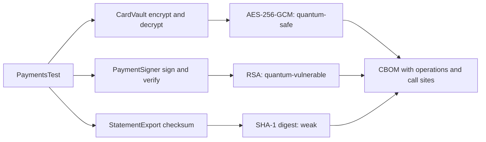

# Explore the payments demo

The included payments demo produces findings you can trace directly to application code: AES-256-GCM encryption, RSA-2048 signatures, and a legacy SHA-1 checksum. Run it to learn how workload, observation, and policy relate before integrating a larger application.

## Build the example

Complete [source installation](../getting-started/installation.md), then stay in the Census repository root. The demo's [POM](https://github.com/DevelopmentSprint/crypto-census/blob/develop/census-demo/pom.xml) already activates `prepare-agent` and `check`.

Run the demo as a separate Maven consumer invocation:

```sh
./mvnw -B -ntp -pl census-demo clean verify
```

This executes [PaymentsTest](https://github.com/DevelopmentSprint/crypto-census/blob/develop/census-demo/src/test/java/com/developmentsprint/cryptocensus/demo/PaymentsTest.java), prints the observed findings, and writes `census-demo/target/cryptocensus/cbom.json`. Runtime/provider observations can add assets, so avoid treating an exact component count as the contract.

## Connect findings to code

| Demo class | Exercised behavior | Expected policy interpretation |
|---|---|---|
| [CardVault](https://github.com/DevelopmentSprint/crypto-census/blob/develop/census-demo/src/main/java/com/developmentsprint/cryptocensus/demo/CardVault.java) | Generates an AES-256 key, encrypts, and decrypts with GCM. | Quantum-safe AES-256-GCM observations. |
| [PaymentSigner](https://github.com/DevelopmentSprint/crypto-census/blob/develop/census-demo/src/main/java/com/developmentsprint/cryptocensus/demo/PaymentSigner.java) | Generates RSA-2048 keys and signs/verifies with SHA256withRSA. | Quantum-vulnerable public-key observations. |
| [StatementExport](https://github.com/DevelopmentSprint/crypto-census/blob/develop/census-demo/src/main/java/com/developmentsprint/cryptocensus/demo/StatementExport.java) | Requests a SHA-1 digest for a legacy checksum. | Weak digest observation. |

These are illustrative migration findings, not recommendations to copy the demo into a production payment system. The SHA-1 path is deliberately legacy. See the [policy reference](../POLICY.md) for the distinction between digest, signing, and verification judgments.



## Inspect the report

[Browse the published CI example](./example-cbom.md) to explore the same workload’s observed assets, verdicts, and call sites before running it yourself.

Open `census-demo/target/cryptocensus/cbom.json` in your editor. Find `bomFormat`, `specVersion`, cryptographic components, and the `cryptocensus:` properties. Follow an application call site back to the corresponding demo class.

Check collection-health and target metadata as well as risk verdicts. An inventory with no observed errors is still limited to the executed tests. Counts reflect the observed initialization/entry-point calls rather than bytes processed or every cryptographic operation.

The report contains inventory metadata and code locations, not the demo card number, plaintext payment instructions, or secret key bytes. Treat the inventory itself as potentially sensitive when applying this workflow to a real application.

## Tighten the gate

The demo defaults to `broken`, so its deliberately weak and quantum-vulnerable examples demonstrate findings without automatically failing that threshold. Run a stricter gate:

```sh
./mvnw -B -ntp -pl census-demo clean verify -Dcensus.failOn=quantum-vulnerable
```

Expect Maven to fail because the observed RSA and SHA-1 paths violate the selected threshold. When `check` reaches policy evaluation, it writes the merged CBOM before reporting the policy failure. A test failure earlier in the lifecycle is different; use [explicit CI finalization](../guides/ci.md) to preserve available evidence in that case.

## Apply the lesson to your application

Map each finding to a real use and owner before choosing remediation. Expand tests around unobserved workflows, provider configuration, and relevant TLS sessions. Keep the source revision and workload description with the report so a later comparison explains what changed.

Proceed to [Maven project setup](maven-project.md) to instrument your own tests, or [enterprise delivery](../guides/enterprise-delivery.md) to preserve and publish this evidence through an explicit destination contract.
