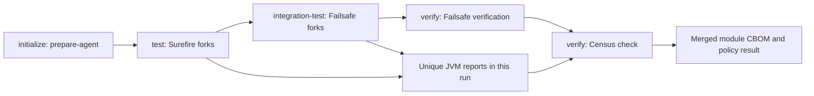

# Add Census to a Maven application

Census integrates into the existing Maven test lifecycle. `prepare-agent` supplies the JVM argument in `initialize`; forked tests collect evidence; `check` merges and evaluates that invocation's reports in `verify`.

Complete [source installation](../getting-started/installation.md). The examples below modify your application's `pom.xml`; keep its existing dependencies, compiler settings, and test framework.

## Start with the standard lifecycle

Add the [quickstart plugin](../getting-started/index.md#install-and-configure-the-plugin) under `<build><plugins>`, then run:

```sh
mvn verify
```

Use your application's `./mvnw` instead if it has a wrapper. The report appears at `target/cryptocensus/cbom.json`. A declaration only under `<pluginManagement>` supplies defaults but does not activate execution.

Tests must fork. A `forkCount` of zero runs tests inside Maven's JVM and prevents the prepared test-JVM agent argument from taking effect. Missing-data checks help detect this but cannot prove that every separate execution attached.

## Preserve a custom Surefire argument line

When you already have JVM options, give Census a dedicated property and compose it with Surefire late binding. Add or merge the following into your existing POM:

```xml
<properties>
  <censusArgLine></censusArgLine>
</properties>
<build>
  <plugins>
    <plugin>
      <groupId>com.developmentsprint</groupId>
      <artifactId>census-maven-plugin</artifactId>
      <version>0.1.0</version>
      <configuration>
        <propertyName>censusArgLine</propertyName>
      </configuration>
      <executions>
        <execution>
          <goals>
            <goal>prepare-agent</goal>
            <goal>check</goal>
          </goals>
        </execution>
      </executions>
    </plugin>
    <plugin>
      <groupId>org.apache.maven.plugins</groupId>
      <artifactId>maven-surefire-plugin</artifactId>
      <version>3.5.4</version>
      <configuration>
        <argLine>@{censusArgLine} -Xmx1g</argLine>
      </configuration>
    </plugin>
  </plugins>
</build>
```

Late binding reads the property after `prepare-agent` sets it. Keep the empty property for profiles that disable preparation. Avoid command-line `-DargLine`; configure your custom flags in the POM.

If JaCoCo also prepares an agent, preserve both prepared properties. Use the complete [JaCoCo recipe](../RECIPES.md#jacoco-and-custom-jvm-options), which defines `argLine` and `censusArgLine` separately and composes `@{argLine} @{censusArgLine}`.

## Include integration tests

Configure Failsafe's `argLine` with the same late-bound Census property, and bind its `integration-test` and `verify` goals. Place Failsafe before Census in the plugin list so its verification runs first. The [Failsafe recipe](../RECIPES.md#failsafe) supplies the full configuration.



Run through `verify`, not only `integration-test`. A failed test can stop the lifecycle before Census checks it; CI should independently [finalize and enforce](../guides/ci.md) available evidence. Do not invoke `check` in a fresh Maven process and expect it to authenticate a previous invocation's reports.

## Handle multiple modules

Put the plugin under the parent's `<build><plugins>` to inherit it into participating modules, or opt in each child explicitly. Each module writes its own merged report and checks its own current-run JVM evidence.

```sh
mvn -T 2 verify
```

Keep per-module destinations. `check` is not a reactor-wide aggregate goal, and shared merged output filenames can overwrite another module's report. Archive or deliver the child reports separately, with their own module correlation values.

## Verify the integration

Confirm that each relevant execution forks with Census attached, reports new evidence, and uses the intended policy. Then deliberately exercise a known weak or quantum-vulnerable demo path under a stricter threshold to check the gate in a controlled test project.

Use the [Maven reference](../MAVEN.md) for complete parameters and check guarantees, including custom report directories and reviewed exceptions. If evidence is missing, follow the [collection decision tree](../troubleshooting/index.md) before changing failure settings.
