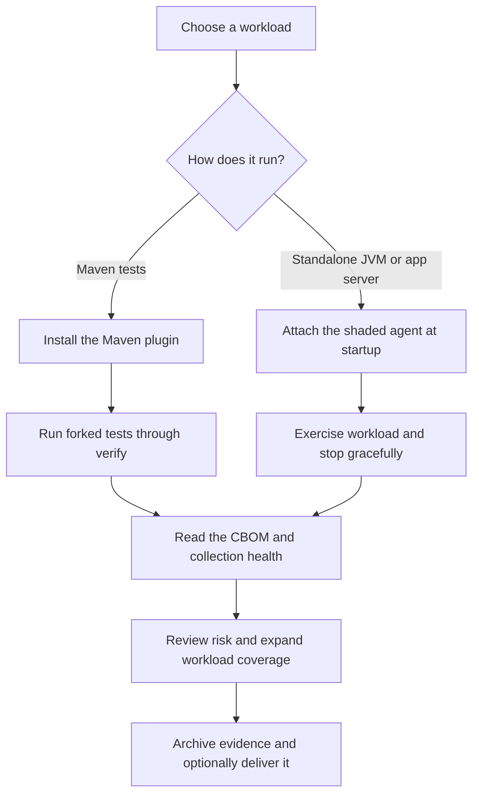

# Start with an observed crypto inventory

Crypto Census answers a practical question: which cryptography does this Java workload actually use, and where does it use it? The agent observes JCA and JSSE entry points while your application runs, then writes a CycloneDX 1.6 Cryptography Bill of Materials (CBOM).

Start with tests. They provide a repeatable workload, a controlled shutdown, and a natural place to enforce policy. Add staging workloads when you need to observe behavior that tests do not exercise.

## Choose your first route



| Your objective | Start here |
|---|---|
| See findings immediately | [Run the included payments example](../examples/crypto-walkthrough.md). |
| Add Census to an application | [Maven project setup](../examples/maven-project.md). |
| Observe a server or packaged application | [Runtime deployment](../guides/runtime-deployment.md). |
| Preserve reports even when tests fail | [CI evidence workflow](../guides/ci.md). |
| Send evidence to a company system | [Enterprise delivery](../guides/enterprise-delivery.md). |

## Install the candidate first

Version `0.1.0` is an unpublished candidate. Build and install it from source before using the plugin coordinates. Follow [installation](installation.md) with JDK 21 or newer for the full build; the resulting agent runs on supported Java 17+ runtimes.

After local installation, add this plugin under your application's `<build><plugins>` in `pom.xml`:

```xml
<plugin>
  <groupId>com.developmentsprint</groupId>
  <artifactId>census-maven-plugin</artifactId>
  <version>0.1.0</version>
  <executions>
    <execution>
      <goals>
        <goal>prepare-agent</goal>
        <goal>check</goal>
      </goals>
    </execution>
  </executions>
</plugin>
```

Run `mvn verify` from that application. Census prepares the agent in `initialize`, attaches it to forked test JVMs, and checks their evidence in `verify`. The merged report is `target/cryptocensus/cbom.json`.

If your project already sets `argLine`, uses JaCoCo, or has multiple Failsafe executions, complete the [Maven integration example](../examples/maven-project.md) before treating the result as complete. Every relevant test JVM needs its own attachment.

## Read the result correctly

A finding contains an algorithm and operation, an observed key size when available, a risk verdict, and application call sites. Counts describe observed entry-point events: one `Cipher.init` is one event even if the cipher subsequently processes many messages.

By default, broken cryptography and unknown verdicts fail the build. Missing evidence and incomplete collection also fail. A successful default build can still report weak or quantum-vulnerable algorithms; raise the policy threshold deliberately when your migration plan is ready.

A report covers executed instrumented paths. It cannot establish that unexecuted code is safe, identify every dependency in the application, or prove that every expected JVM attached. Pair it with your software SBOM, source analysis, test coverage, and human review. Read the [policy](../POLICY.md) and [safety boundaries](../SAFETY.md) before interpreting inventory as assurance.

## Plan the next improvement

Preserve the initial report as a baseline with its source revision and workload description. Review unknowns and collection warnings first, then assign migration work to the call sites behind the findings. Broaden the workload and compare new evidence instead of treating a single clean run as complete discovery.
