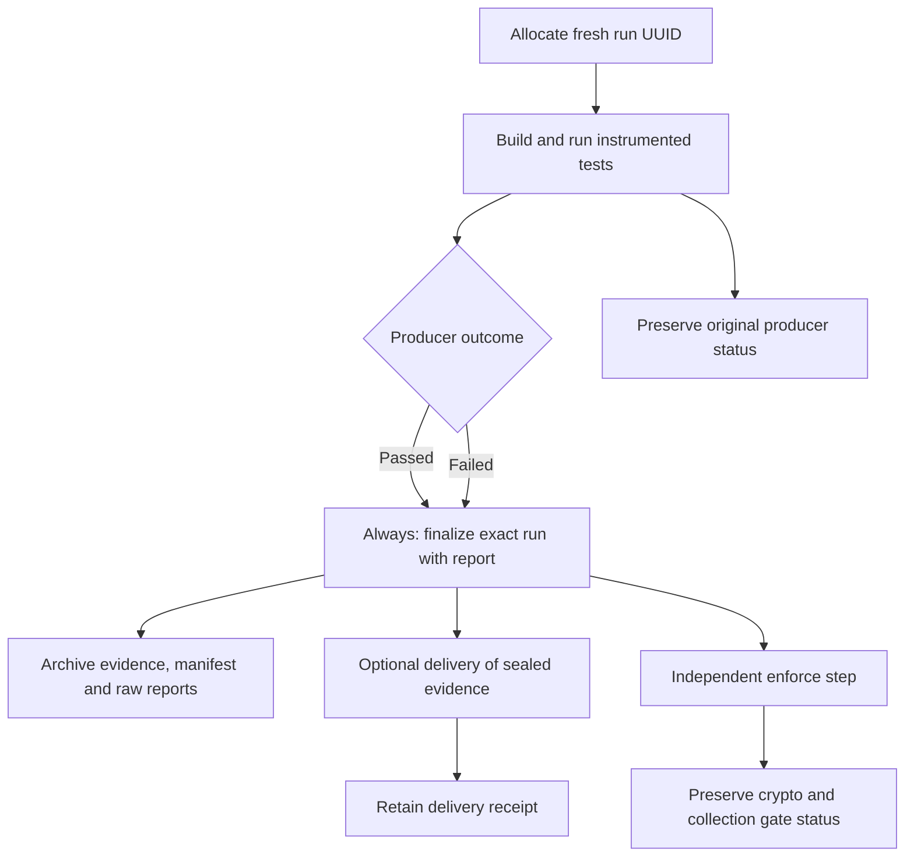

# Preserve evidence throughout CI

A useful CI scan keeps three outcomes separate: whether the application build passed, whether observed cryptography meets policy, and whether evidence reached its destination. Preserve all three even when one fails.

The normal `prepare-agent` and `check` lifecycle is enough for local feedback. CI also needs explicit finalization because a failed Surefire test or an earlier Maven error can prevent `verify` from reaching `check`.



## Install Census on the runner

Install the plugin in the runner’s Maven repository before running the application build. This repository uses the following bootstrap from the checkout, then runs the demo as the consumer:

```sh
./mvnw -B -ntp -pl census-maven-plugin -am clean install -DskipTests -Dinvoker.skip=true
```

Only bootstrap skips tests. In your own CI, install Census from the intended revision into the repository used by the application build. Run the application's normal tests with the [plugin configured](../examples/maven-project.md).

## Give each attempt an identity

Allocate a fresh lowercase UUID for every attempt, including retries. Pass it to the producing Maven invocation and retain it as trusted CI job state:

```sh
run_id="$(python3 -c 'import uuid; print(uuid.uuid4())')"
./mvnw verify -Dcensus.runId="$run_id"
```

These commands run from the consuming application's root. A failed command must remain a failed producer step; do not append successful reporting commands in a way that replaces its exit status. CI's separate `always` or `finally` steps handle finalization.

Run identity belongs to the producer, not to a filename chosen by a later uploader. Reusing the same module/run identity in a second Maven invocation fails. Each module adds its own hash, so separate modules remain isolated under a shared run UUID.

## Finalize even when the producer fails

In a separate always-run CI step, translate the actual producer result to `passed`, `failed`, or `unknown`, and run:

```sh
./mvnw com.developmentsprint:census-maven-plugin:0.1.0:report \
  -Dcensus.runId="$run_id" -Dcensus.testOutcome=failed
```

The example uses `failed`; replace it with the actual outcome. Do not run `clean` between collection and finalization. `report` reads only the exact registered run and creates an immutable revision containing `evidence.json` and `manifest.json`.

Missing or corrupted evidence fails finalization. Policy failures and incomplete collection are recorded in a valid report and remain available for independent enforcement. A killed JVM may never produce evidence; an interrupted or cancelled runner may never execute finalization.

## Retain the exact manifest path

With default destinations, each module writes beneath:

```text
target/cryptocensus/
  run-<runId>-<SHA256 of UTF-8 groupId:artifactId>/
    run.json
    cbom-<per-JVM identity>.json
    revisions/
      1/
        evidence.json
        manifest.json
```

Derive the module path from the known identity as the [dogfood workflow](https://github.com/DevelopmentSprint/crypto-census/blob/develop/.github/workflows/ci.yml) does, or preserve the exact path reported by your pipeline. Never select the newest directory or a previous run's artifact as a fallback.

Archive the descriptor, selected revision, and original JVM files. The manifest binds their hashes and records policy, collection health, producer outcome, and finalization time. These files are local workflow evidence, not signed attestations that every expected JVM participated.

## Deliver and enforce independently

Optional delivery consumes the sealed artifact and verifies its manifest. With profile delivery, bind `census.manifest`, `census.runId`, and `census.delivery.application` on each action, and configure the matching merged CBOM and correlation in the profile. See the [complete finalization reference](../CI-FINALIZATION.md#deliver-and-enforce-independently).

Run enforcement in its own always-run step so a destination outage cannot suppress it:

```sh
./mvnw com.developmentsprint:census-maven-plugin:0.1.0:enforce \
  -Dcensus.manifest="$manifest" -Dcensus.runId="$run_id"
```

Set `manifest` to the exact absolute manifest path for this module and revision. Preserve the policy configuration used during finalization; enforcement rejects policy drift and verifies the original and merged bytes. Do not use blanket `continue-on-error` to turn a failed producer or policy gate into a passing build.

## Find this repository's downloadable evidence

Open a [CI workflow run](https://github.com/DevelopmentSprint/crypto-census/actions/workflows/ci.yml) and its **Maven plugin dogfood / runtime CBOM** job. The **crypto-census-cbom** artifact contains sealed `evidence.json` and `manifest.json`; **crypto-census-cbom-jvm-reports** contains the descriptor and individual JVM reports when available. The workflow configures 14-day retention.

The job exercises the payments demo, not every code path in Census itself. A workflow artifact is downloadable evidence; it does not prove enterprise ingestion or a complete dependency inventory. Review artifact visibility and retention before applying the same pattern to private application CBOMs.
