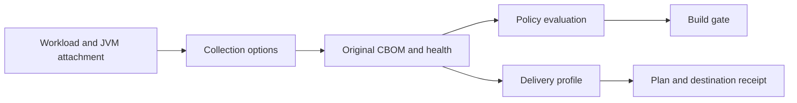

# Configure collection, policy, and delivery

Census separates what it observes, how it judges findings, and where it delivers evidence. Configure these concerns independently so a delivery outage cannot silently relax a crypto policy or change the collected artifact.



## Find the right configuration surface

| Concern | Maven application | Standalone JVM or CLI | Complete reference |
|---|---|---|---|
| Agent attachment and output | `prepare-agent`, `census.destDir` | `-javaagent`, `output` or `dir` | [Maven](../MAVEN.md), [agent operations](../OPERATIONS.md) |
| TLS observation and bounds | `census.tls`, `census.maxAssets`, `census.maxSites` | `tls`, `maxAssets`, `maxSites` | [Agent options](../OPERATIONS.md#agent-options) |
| Severity and evidence gates | `check` or `enforce` | Review the emitted verdicts and health in your workflow | [Policy](../POLICY.md), [Maven check](../MAVEN.md#check) |
| Finalized run identity | `census.runId`, `report`, `census.manifest` | Consume the exact sealed evidence artifact | [CI finalization](../CI-FINALIZATION.md) |
| Enterprise destination | `delivery` plus a JSON profile | CLI `delivery` plus the same profile | [Delivery profiles](../DELIVERY-PROFILES.md) |
| CA, proxy, retries | Explicit delivery transport options | Explicit delivery transport options | [Delivery operations](../DELIVERY-OPERATIONS.md) |

The tables in the linked references are authoritative. This guide explains common decisions rather than duplicating every default and limit.

## Start with collection defaults

The agent keeps bounded in-memory observations and writes at graceful shutdown. In a standalone process, use `output` for one known file or `dir` for unique per-JVM files. The Maven plugin manages unique run directories automatically.

Agent options use comma-separated `key=value` entries. Percent-encode commas, equals signs, percent signs, and spaces inside values; the Maven plugin performs this encoding for its supported parameters. Unknown or invalid standalone options produce startup warnings, so include stderr in operational checks.

Increase `maxAssets` only when the report shows dropped assets and the larger bound fits the workload. `maxSites` controls retained attribution, and excess attribution can fold into `<overflow>`. Count limits do not remove the independent serialization and parsing budgets described in [output budgets](../OPERATIONS.md#output-budgets).

## Choose an explicit policy posture

The default severity threshold is `broken`. To reject weak and quantum-vulnerable findings too, run the application lifecycle with:

```sh
mvn verify -Dcensus.failOn=quantum-vulnerable
```

For a risk-reporting rollout, disable severity and unknown failures explicitly:

```sh
mvn verify -Dcensus.failOn=none -Dcensus.failOnUnknown=false
```

Missing-data and incomplete-collection checks still apply. A risk-reporting rollout should preserve evidence quality; disabling evidence failures does not repair missing attachment or instrumentation.

An explicit plugin XML value takes precedence over the corresponding command-line property. Prefer defaults or a POM property for values you intend to override in CI. Keep reviewed exceptions narrow, with an owner, rationale, and review date; Census exceptions do not expire automatically and are not scoped to a call site.

## Compose test JVM options deliberately

Surefire and Failsafe need forked JVMs, with the Census argument included in every relevant execution. A hard-coded `argLine` or command-line `-DargLine` can replace an agent argument prepared earlier in the lifecycle.

Use a dedicated `censusArgLine` property and late binding when composing multiple agents. The [Maven example](../examples/maven-project.md) and [JaCoCo recipe](../RECIPES.md#jacoco-and-custom-jvm-options) show the complete configuration. An observed unit-test JVM cannot establish that an unrelated integration-test execution attached.

## Keep delivery credentials out of profiles

Profiles contain secret references, such as environment variable names or Maven settings server IDs. Planning does not resolve those references or contact the network; preflight and publication resolve them after validating the plan and input bytes.

A destination chooses its authentication scheme. Basic-auth adapters require paired references; bearer adapters require their compatible token reference. Upload, independent evidence readback, and proxy authentication are separate credentials and can have separate privileges.

Configure a custom CA bundle only for the selected delivery client, and use an explicit proxy when required. Do not replace hostname verification with a permissive global JVM setting. See [delivery troubleshooting](../troubleshooting/delivery.md) when transport validation rejects a configuration.
