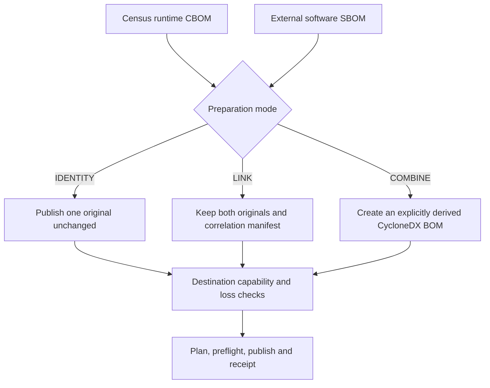
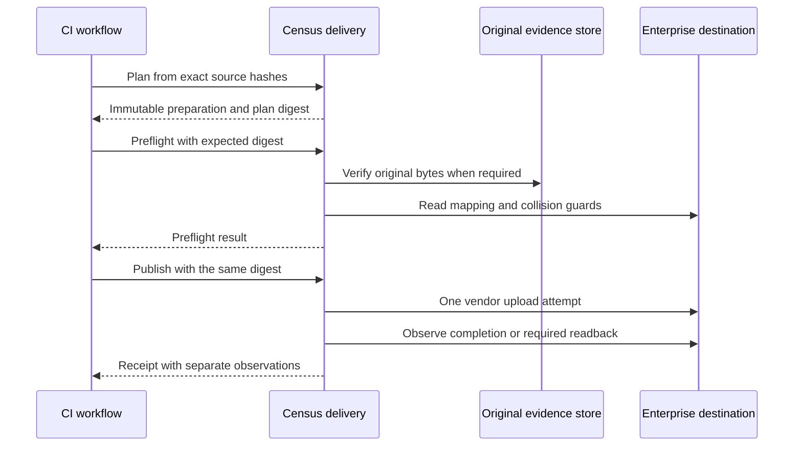

# Deliver cryptographic evidence to enterprise systems

Census produces runtime cryptographic evidence. Continue generating your complete software SBOM with the tool responsible for dependency graphs, packages, and licenses. Delivery profiles connect these documents to company workflows without pretending that every destination preserves every crypto field.

## Choose the evidence relationship

`IDENTITY` preserves one document's bytes. `LINK` retains separate documents and a correlation manifest, then publishes the unchanged CBOM; it does not create a relationship in a vendor UI. `COMBINE` creates a new derivative with explicit transformation evidence and losses; signatures on the originals do not sign the derivative.

Use [SBOM preparation](../SBOM-PREPARATION.md) to choose supported input kinds and understand transformation limits. A caller-supplied application/module/version/run mapping is a correlation assertion, not proof that a software component owns a crypto observation.

## Select a destination by required evidence

| Destination | Best fit | What successful delivery establishes | What it does not establish |
|---|---|---|---|
| [Generic HTTPS](../DELIVERY-PROFILES.md#start-with-exact-byte-https-delivery) | An existing company evidence receiver. | Bounded HTTP acceptance of the publication. | Semantic ingestion or durable retention. |
| [Dependency-Track](../DEPENDENCY-TRACK.md) | A guarded runtime inventory separate from software inventory. | Completion for the explicitly tested 5.2.0 contract. | Full CBOM fidelity; measured losses require explicit acceptance. |
| [JFrog Artifactory](../ARTIFACTORY.md) | Exact artifact storage in a scoped repository. | Accepted upload and exact-byte download comparison. | Xray ingestion or searchable crypto inventory. |
| [Sonatype SBOM Manager](../SONATYPE-SBOM-MANAGER.md) | An explicitly mapped application and new version. | Matching import completion and exact original download. | Verified preservation of crypto semantics in inventory. |
| [Anchore Enterprise](../ANCHORE.md) | An SBOM asset in a dedicated application version. | Matching import job and asset completion. | Native original retention or crypto-field fidelity. |

Artifactory, Sonatype, and Anchore are experimental, contract-tested integrations. Tests use isolated HTTPS fixtures; they do not certify a commercial tenant. Dependency-Track's measured contract is version-specific and explicitly lossy. Read the destination guide before configuring credentials or accepting its loss codes.

## Use the same workflow in Maven or the CLI

1. Preserve the original CBOM and its trusted SHA-256 digest.
2. Create a profile with explicit correlation, destination mapping, preparation, and separate output paths.
3. Run offline `plan` and keep the printed plan digest in trusted CI state.
4. Run `preflight` with that digest to perform the supported read-only checks.
5. Run `publish` with the same profile and digest, then archive the receipt.

The [profile reference](../DELIVERY-PROFILES.md) provides a complete executable JSON shape and exact CLI/Maven commands. Planning resolves no secrets and makes no network request. Changed inputs, destination settings, capabilities, or CA bytes require a new plan and new immutable preparation paths.

Independent original retention is mandatory for Dependency-Track, Sonatype, and Anchore. Your evidence-store workflow uploads the original first; Census retrieves and hashes it before vendor mutation. That read proves retrieval at that moment, not a future retention guarantee.

## Prevent inventory replacement

Treat project and application mapping as a security boundary. Dependency-Track needs a preprovisioned owned runtime project, not the project that receives the full software SBOM. Anchore requires a dedicated runtime version and single writer; Sonatype requires a new version with a single writer per target. Artifactory requires restricted read/deploy permissions without overwrite/delete access.

A preflight read does not atomically reserve a name or version. Follow each adapter's concurrency and permission requirements, and reconcile ambiguous uploads before trying again. Vendor uploads have one mutation attempt; automatic retry support is limited to a generic receiver with an explicitly asserted idempotency contract.

## Decide what counts as success

Receipts distinguish upload acceptance, ingestion completion, original retention, destination readback, and semantic preservation. A successful HTTP response is only one observation. Required exact-byte readback can fail the delivery gate even after the server accepted an upload.

If you require searchable, field-preserving crypto inventory, verify those semantics on the exact target version before adoption. Accepting named loss codes records a conscious allowance; it does not turn an unverified capability into a proven one. Keep original evidence available independently of the target UI.

For CI that must finalize evidence after failed tests, bind delivery to the exact sealed manifest as described in the [CI guide](ci.md). Use [delivery troubleshooting](../troubleshooting/delivery.md) for failures, and [delivery operations](../DELIVERY-OPERATIONS.md) for proxy, retry, and credential configuration.
