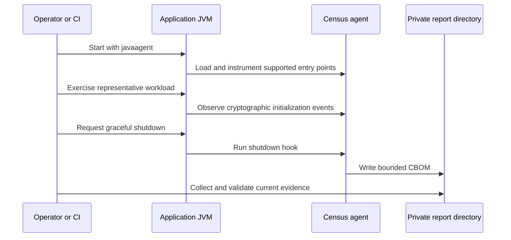
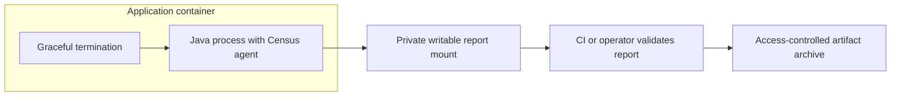

# Run in standalone JVMs, containers, and servers

Attach Census when the JVM starts, exercise the workload, and collect its report after graceful shutdown. No Census application server or remote collector is required. The current deployment focus is tests and staging because production overhead is not benchmarked and periodic flushing is not implemented.

## Start a standalone application

[Build and acquire the shaded agent](../getting-started/installation.md), then run from the application directory:

```sh
java -javaagent:census-agent.jar=output=cbom.json,app=payments-api -jar payments-api.jar
```

Replace `payments-api.jar` with your application. `output=cbom.json` resolves from the process working directory, and the JVM user needs permission to create and rename files there. The application still owns its normal startup and shutdown behavior.

For multiple JVMs, give each process a unique output or use a private report directory:

```sh
java -javaagent:census-agent.jar=dir=/private/reports,app=payments-api -jar payments-api.jar
```

Create `/private/reports` with permissions appropriate for the application's user before launch. Directory mode produces unique per-JVM filenames rather than competing for one shared report. Agent option values need percent-encoding for reserved characters; see [agent operations](../OPERATIONS.md#agent-options).

## Design around shutdown



A long-running server does not continuously write its report. Plan an orderly stop at the end of an observation window, and give the process time to finish its shutdown hooks. `SIGKILL`, a JVM crash, or forced container termination can leave no report.

Startup or instrumentation errors keep the host application running. That availability behavior does not mean collection succeeded: inspect stderr, collection-health fields, and instrumentation-target results. A previous report at the destination is not evidence for the latest process.

## Package a container

Keep the agent separate from application source dependencies. Copy the shaded JAR into the image, attach it through the Java startup command, and mount a private output directory owned by the image's runtime user.

The [container recipe](../RECIPES.md#standalone-container) supplies a complete Dockerfile and stop/collect sequence. Use an exec-form entry point so Java receives the termination signal, preserve evidence before removing the container, and allow enough shutdown time. Pin an approved base image; an illustrative tag is not a new compatibility claim.



A writable mount requires the correct UID/GID or ACL, not world-writable permissions. Avoid removing a container before extracting evidence kept only in its filesystem. If your platform forcibly kills a process after a grace period, size that window for the application's shutdown plus report generation.

## Integrate with an application server

Add the `-javaagent` option to the server JVM, preserving its existing JVM flags and other agents. Open Liberty uses its server `jvm.options`; WildFly commonly composes `JAVA_OPTS`. Follow the [Liberty](../RECIPES.md#open-liberty) or [WildFly](../RECIPES.md#wildfly) recipe for the exact tested arrangement.

The [conformance matrix](../CONFORMANCE.md#app-servers-and-other-agents) identifies pinned tested combinations. A passing result on one server version does not certify every server, vendor JVM, or APM agent combination. Review target coverage and health again when changing the runtime.

## Decide between CI and staging

| Environment | Value | Operational requirement |
|---|---|---|
| Unit and integration tests | Repeatable evidence and fast policy feedback. | Fork every relevant JVM and exercise useful crypto paths. |
| Staging application | Observes realistic configuration, providers, and request flows. | Define an observation window and a reliable graceful stop. |
| Long-running production application | May expose workloads absent from tests. | Requires your own performance and operational evaluation; current tooling has no periodic flush. |

Start with CI, expand representative tests, then use staging to investigate provider, server, or TLS behavior. Preserve workload context beside each report so readers know what execution the evidence describes. Consult [safety](../SAFETY.md) before trusting in-process evidence against hostile application code.
