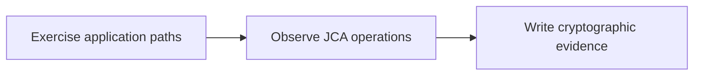
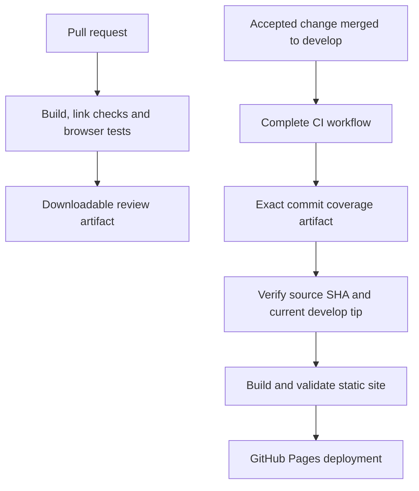

# Maintain the documentation site

The site builds the Markdown files in `docs/` with VitePress. The same reference documents remain readable in the GitHub repository. There is no application server, analytics service, hosted search account or documentation database: GitHub Pages serves static HTML, styles, scripts and the local search index.

## Run locally

Use Node.js 24 (the CI version), Python 3 and a current browser. The dependency floor is Node.js 22.12. From the repository root:

```sh
npm ci
npm run docs:dev
```

Open the loopback URL printed by VitePress. The site lives under `/crypto-census/`, including in local previews. To validate the production output:

```sh
npm run docs:typecheck
npm run docs:build
npx playwright install chromium
npm run docs:test
npm run docs:preview
```

`docs:build` checks every generated internal link, fragment and asset after VitePress's own dead-link checks. Browser tests render every Mermaid diagram and check search, theme switching and mobile navigation. Tests start and stop their own loopback preview on an available port. `docs:preview` is for interactive inspection; stop it with Ctrl-C.

The stable VitePress release currently depends on an older Vite major. A scoped, pinned override selects Vite 6.4.4 to address published development-server advisories. Its Vue plugin supports Vite 6; production builds, search, diagrams and browser checks validate this combination. Reassess the override when updating VitePress instead of removing it without auditing the resolved dependency tree.

A local build generates neutral **not measured locally** badges. It never substitutes a guessed coverage percentage. The production workflow requires an artifact whose source SHA matches the documentation checkout; see [coverage provenance](quality.md).

## Organize content

| Directory or file | Purpose |
| --- | --- |
| `getting-started/` | First successful run and installation |
| `concepts/` | Motivation, evidence semantics and limitations |
| `architecture/` | Components, instrumentation and data flow |
| `guides/` | Task-oriented configuration and operations |
| `examples/` | Runnable walkthroughs |
| `troubleshooting/` | Symptoms, diagnosis and recovery |
| Existing uppercase Markdown files | Canonical detailed configuration and operational references |
| `design/`, `research/` | Design decisions, proposals and supporting research |
| `.vitepress/` | Navigation, theme and rendering configuration |
| `public/` | Static assets; coverage badges are generated and ignored by Git |

Link to the canonical reference instead of copying a configuration table into multiple pages. Label proposed features, experimental adapters and historical release plans explicitly. Examples must distinguish unpublished source builds from released artifacts. Code links point to `develop`; update version references when a release changes installation instructions.

Use relative Markdown links such as `[policy](../POLICY.md)`. Links outside `docs/`, such as `../SECURITY.md`, are rendered as GitHub source links. Add new pages to the navigation in `.vitepress/config.mts`; a document without a sidebar entry can still be found by local search.

## Draw diagrams

Use fenced `mermaid` blocks for flowcharts, sequences and state diagrams. Keep node labels short, explain the diagram in surrounding prose, and provide useful text for readers who cannot see it. Quote labels containing punctuation. Complex diagrams should be split into focused views rather than compressed into an unreadable chart.

````markdown

````

Mermaid is bundled locally and renders with strict security settings. Raw HTML labels and interactive callbacks are unnecessary. Each diagram has a source disclosure for inspection and a visible fallback if rendering fails. The browser suite treats rendering failures as failures, including diagrams added to existing references.

## Publish through CI



The documentation workflow validates pull requests without publishing them. Deployment runs only after a successful `CI` workflow triggered by a push to this repository's `develop` branch. It checks out that exact source SHA and downloads `docs-coverage` from that exact run. Missing evidence or a mismatched SHA stops publication. A second branch-tip check prevents a delayed build from deploying after `develop` has already advanced.

Only the deployment job has `pages: write` and `id-token: write`. Build jobs have read permissions. Actions use full commit pins, dependencies use the npm lockfile, and dependency audit runs with the documentation checks. No personal token or external badge service credential is required.

A repository administrator must configure **Settings → Pages → Build and deployment → Source: GitHub Actions** before the first deployment. Configure the `github-pages` environment to allow `develop` deployments and apply any desired approval policy. The workflow then publishes to:

<https://developmentsprint.github.io/crypto-census/>

The site tracks the development branch and identifies the current version as a prerelease. Changes do not publish merely because a local build passes. Follow the repository's review and acceptance process before merging.

## Diagnose a failed publication

- **No deployment run:** confirm the upstream CI workflow completed successfully on a `develop` push. Pull requests and failed CI runs intentionally do not deploy.
- **Missing coverage artifact:** inspect the Temurin 25 Ubuntu CI row and its export/upload steps. Coverage artifacts expire after 30 days; use a fresh trusted CI run.
- **Source mismatch or stale source:** the workflow will not combine documentation from one commit with coverage from another. Let CI complete for the current branch tip.
- **Pages permission or environment error:** check the repository's Pages source, Actions permissions and `github-pages` deployment branch policy.
- **Broken navigation or missing diagram:** reproduce with the production build and browser tests above; fix the source instead of disabling validation.

The README coverage badge links to measured provenance. A failing or pending build leaves the previous successful site's measurement in place; the current source SHA remains visible in `badges/coverage.json`.
