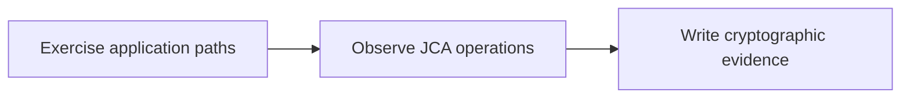
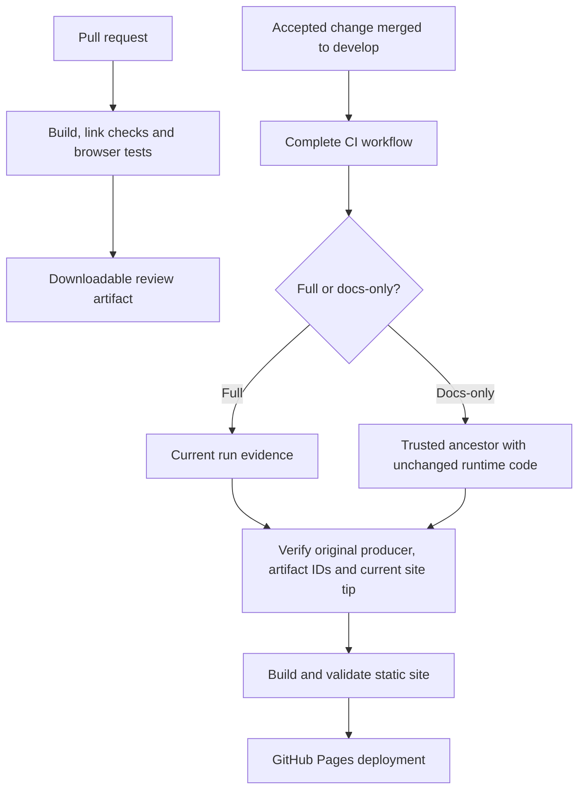

# Maintain the documentation site

The site builds the Markdown files in `docs/` with VitePress. The same reference documents remain readable in the GitHub repository. There is no application server, hosted search account or documentation database: GitHub Pages serves static HTML, styles, scripts and the local search index.

## Run locally

Use Node.js 24 (the CI version), Python 3 and a current browser. The dependency floor is Node.js 22.12. From the repository root:

```sh
npm ci
npm run docs:dev
```

Open the loopback URL printed by VitePress. The custom-domain site lives at `/`, including in local previews. To validate the production output:

```sh
node --test scripts/docs/prepare_test.mjs scripts/docs/analytics_test.mjs
python3 scripts/coverage_badges_test.py
python3 -m unittest discover -s scripts/docs -p '*_test.py'
npm run docs:typecheck
npm run docs:build
npx playwright install chromium
npm run docs:test
npm run docs:preview
```

`docs:build` checks every generated internal link, fragment and asset after VitePress's own dead-link checks. Browser tests render every Mermaid diagram and check search, theme switching and mobile navigation. Tests start and stop their own loopback preview on an available port. `docs:preview` is for interactive inspection; stop it with Ctrl-C.

The stable VitePress release currently depends on an older Vite major. A scoped, pinned override selects Vite 6.4.4 to address published development-server advisories. Its Vue plugin supports Vite 6; production builds, search, diagrams and browser checks validate this combination. Dependabot proposes weekly documentation dependency updates to `develop`. Reassess the override when updating VitePress instead of removing it without auditing the resolved dependency tree.

A local build generates neutral **not measured locally** badges. It never substitutes a guessed coverage percentage. The production workflow requires an artifact whose source SHA matches the documentation checkout; see [coverage provenance](quality.md).

## Organize content

| Directory or file | Purpose |
| --- | --- |
| `getting-started/` | First successful run and installation |
| `concepts/` | Motivation, evidence semantics and limitations |
| `architecture/` | Components, instrumentation and data flow |
| `guides/` | Task-oriented configuration and operations |
| `examples/` | Runnable walkthroughs |
| `troubleshooting/` | Symptoms, diagnosis and recovery |
| Existing uppercase Markdown files | Canonical detailed configuration and operational references |
| `design/`, `research/` | Design decisions, proposals and supporting research |
| `.vitepress/` | Navigation, theme and rendering configuration |
| `public/` | Static assets; coverage badges and example CBOM files are generated and ignored by Git |

Link to the canonical reference instead of copying a configuration table into multiple pages. Label proposed features, experimental adapters and historical release plans explicitly. Examples must distinguish unpublished source builds from released artifacts. Code links point to `develop`; update version references when a release changes installation instructions.

Use relative Markdown links such as `[policy](../POLICY.md)`. Links outside `docs/`, such as `../SECURITY.md`, are rendered as GitHub source links. Add new pages to the navigation in `.vitepress/config.mts`; a document without a sidebar entry can still be found by local search.

## Draw diagrams

Use fenced `mermaid` blocks for flowcharts, sequences and state diagrams. Keep node labels short, explain the diagram in surrounding prose, and provide useful text for readers who cannot see it. Quote labels containing punctuation. Complex diagrams should be split into focused views rather than compressed into an unreadable chart.

````markdown

````

Mermaid is bundled locally and renders with strict security settings. Raw HTML labels and interactive callbacks are unnecessary. Each diagram has a source disclosure for inspection and a visible fallback if rendering fails. The browser suite treats rendering failures as failures, including diagrams added to existing references.

## Publish through CI



The documentation workflow validates pull requests without publishing them. Deployment runs only after a successful `CI` workflow triggered by a push or manual dispatch on this repository's `develop` branch. It checks out that exact **site source SHA**. Full runs prefer that run's `docs-coverage` and `docs-cbom` artifacts. Docs-only runs reuse a prior producer only after the verification described below. Missing evidence, an untrusted producer or a mismatched identity stops publication. Deployments are serialized with a queue that preserves waiting jobs. A second branch-tip check inside the deployment job skips a delayed build after `develop` has already advanced. A stale CI completion cannot cancel or replace a newer pending publication.

### Reuse evidence without claiming a new measurement

The shared changed-path classifier skips Java jobs only for the [documented allowlist](../CONTRIBUTING.md#documentation-only-checks). The documentation build still installs locked dependencies, audits them, runs provenance tests, type checks, builds the site, checks links and exercises the browser suite.

`scripts/docs/evidence_source.py` first tries the exact successful triggering CI run. Otherwise it searches earlier successful runs of this repository's CI workflow on `develop`. A producer must be an original-repository push or explicit manual CI run, have both unique unexpired artifacts, and have a source commit present in the fetched Git history. That source must be an ancestor of the current site source, with only allowed regular-file documentation changes in the entire Git diff. Artifact download uses the verified artifact IDs and original run ID. Fork, pull-request, failed, unrelated-branch, nonancestor, expired and runtime-different candidates cannot qualify.

Before building, preparation rechecks Git ancestry and code equivalence, then checks coverage and CBOM metadata against the **evidence source SHA** and producing run. It copies the original bytes; it does not relabel the artifacts with the newer documentation commit. The example viewer's commit and run links continue to identify what generated its CBOM. [site-evidence.json](https://cryptocensus.developmentsprint.com/site-evidence.json) separately records the site commit, evidence commit and whether they differ. Its `selectedRunAttempt` identifies the successful run attempt used for selection; the CBOM index retains its actual artifact-producing attempt. Coverage metadata has no attempt field, so the site does not invent one.

If no qualifying evidence exists, publication stops with an actionable message. It does not silently start an expensive Java fallback or fabricate new coverage/CBOM data. This can happen after artifact expiry or after a runtime change whose full CI run has not passed. Dispatch **CI** on `develop` with the GitHub Actions UI or `gh workflow run ci.yml --ref develop` to regenerate both artifacts. Manual CI runs always use the full path. A successful manual run then triggers the usual Pages checks and deployment; stale-tip protections continue to compare the actual site source, not the older evidence source.

### Publish the example CBOM

The public example is the Maven plugin's runtime inventory of the **`census-demo` payments tests**. It is not an exhaustive inventory of this repository or a general dependency SBOM. The published files show what those tests exercised, including cryptographic risk classifications and collection limitations. A healthy manifest means the configured collection policy passed; it does not mean every instrumentation target loaded or every application path ran.

After a successful dogfood job on a trusted `develop` push or manual CI run, `scripts/docs/example_cbom.py package` validates the sealed revision and stages exactly three files for the `docs-cbom` artifact:

| File under `example-cbom/` | Purpose |
| --- | --- |
| `evidence.json` | The original Maven-generated CycloneDX 1.6 CBOM, unchanged |
| `manifest.json` | The original Maven evidence manifest, unchanged |
| `index.json` | Public source commit, CI run and attempt, workload scope, outcomes, download paths and SHA-256 digests |

Preparation verifies the exact merged CBOM bytes against the Maven manifest, the expected demo workload and Maven run identity, and passing test, collection and policy outcomes. It then binds the package to the repository, source SHA, GitHub Actions run ID and producing run attempt. The documentation build independently verifies those bindings against its independently verified producer selection and checks both download digests before copying the allowlisted files into `docs/public/example-cbom/`. Extra files, symlinks, unexpected paths and malformed or missing evidence stop the build. Raw per-JVM reports, separate run descriptors, logs, and private tracker state are not copied into the documentation artifact.

The manifest retains hashes of its individual JVM input reports. The website preparation checks the merged artifact hash; it does not independently reverify those raw reports, which are not included in the Pages bundle. Hashes establish byte consistency, not a signature or independent proof that the CI runner is trustworthy.

Pull-request and ordinary local builds generate an explicit **unavailable** example state. They never publish synthetic fixtures as measured evidence or silently reuse an old local CBOM. Test fixtures live only in disposable test directories. The deployed site retains the most recent successful publication when later builds fail, with its source commit and producing run visible. There is one current example, not an accumulating public history of every build.

The artifact expires after 30 days; the successfully deployed static copy remains available until replaced. A successful rerun of the producer replaces the named artifact with a new artifact ID and records its new producing attempt. Partial CI reruns may retain a successful dogfood artifact from an earlier attempt of the same run and source SHA. The page preserves that actual producing attempt; an artifact claiming a future attempt is rejected. Dispatch a fresh full CI run on `develop` if required artifacts are missing or expired. To inspect an actual artifact locally, supply `DOCS_CBOM_DIR`, `DOCS_REPOSITORY`, `DOCS_SOURCE_SHA`, `DOCS_RUN_ID`, `DOCS_RUN_ATTEMPT` and `DOCS_RUN_URL` matching its `index.json`. For reuse by a newer site source, also supply `DOCS_EVIDENCE_SHA` and the selection record `DOCS_EVIDENCE_PROOF`; preparation verifies the actual checkout and Git diff. This verifies the packaged data; the trusted GitHub workflow is what establishes that the metadata came from the intended CI job.

Only the deployment job has `pages: write` and `id-token: write`. Build jobs have read permissions. Actions use full commit pins, dependencies use the npm lockfile, and dependency audit runs with the documentation checks. No personal token or external badge service credential is required.

A repository administrator must configure **Settings → Pages → Build and deployment → Source: GitHub Actions** before the first deployment. Configure the `github-pages` environment to allow `develop` deployments and apply any desired approval policy. The workflow then publishes to:

<https://cryptocensus.developmentsprint.com/>

The site tracks the development branch. Keep release availability in the shared banner in `docs/.vitepress/theme/index.ts`, rather than repeating status notices in individual pages. Update or remove the banner when publication is verified; keep source-build prerequisites and release verification steps in their respective guides. Changes do not publish merely because a local build passes. Follow the repository's review and acceptance process before merging.

## Configure Google Analytics 4

GA4 is optional and disabled when the `DOCS_GA4_MEASUREMENT_ID` repository variable is unset. To enable it:

1. Create or select a GA4 web stream for `https://cryptocensus.developmentsprint.com/` and copy its measurement ID (`G-XXXXXXXXXX`).
2. In GitHub, open **Settings → Secrets and variables → Actions → Variables** and set `DOCS_GA4_MEASUREMENT_ID` to that ID. It is public configuration, not an API key or secret.
3. In the GA4 stream's **Enhanced measurement → Page views → Show advanced settings**, enable **Page loads** and **Page changes based on browser history events**. VitePress uses browser history for navigation. GA4 handles page views; the theme does not emit a second set of manual events. See [Google's SPA measurement guide](https://developers.google.com/analytics/devguides/collection/ga4/single-page-applications).
4. Publish through the next successful `develop` CI run. Setting a repository variable alone does not change an already deployed site. To republish the current source without a code change, rerun its successful CI workflow while that commit remains the `develop` tip and its required artifacts are available.
5. Visit the public site, navigate between documentation pages, and check GA4 Realtime or Tag Assistant/DebugView. Confirm one page view per navigation and the correct page URL. Ad blockers and a browser's Do Not Track setting can intentionally prevent collection.

Only the trusted Pages build receives the ID. PR builds omit the tag. The generated loader also checks the exact public HTTPS origin before contacting Google, so serving a published artifact locally does not generate visits. A malformed nonempty ID fails the build with a configuration error.

When enabled, the site loads Google's tag and uses GA4's normal analytics cookies and enhanced measurement settings. Google signals and advertising personalization signals are disabled in the tag configuration. This integration does not implement a consent banner or consent-management platform. Configure the GA4 property's collection settings for the site's intended use; do not add user identifiers or CBOM contents as custom analytics events.

To disable analytics, remove the repository variable and publish again. If the Pages hostname or base path changes, update the production guard in `scripts/docs/analytics.mjs` as well as the site configuration. Local tests use a dummy measurement ID and do not send events to Google.

## Custom domain and asset paths

GitHub Pages serves this project at the root of `cryptocensus.developmentsprint.com`. Keep VitePress `base: '/'`, the favicon path, sitemap hostname, social preview URL, README badges and local browser-test URLs aligned with that location. Retaining the old `/crypto-census/` base after moving to the custom domain makes stylesheet and JavaScript requests return 404.

The custom domain is configured in **Settings → Pages**, not a repository `CNAME` file: this site's custom Actions deployment ignores that file. Once the certificate is available, enable **Enforce HTTPS** so HTTP visits redirect to the HTTPS origin used by analytics. See [GitHub's custom-domain setup](https://docs.github.com/en/pages/configuring-a-custom-domain-for-your-github-pages-site/managing-a-custom-domain-for-your-github-pages-site).

After deployment, check the home page and a nested documentation page. Both must load their stylesheets with HTTP 200 and `text/css`; verify search, navigation and example-CBOM downloads too. Changing Pages settings does not rebuild previously generated asset paths.

## Diagnose a failed publication

- **No deployment run:** confirm the upstream CI workflow completed successfully on an original-repository `develop` push or manual CI dispatch. Pull requests and failed CI runs intentionally do not deploy.
- **Missing CBOM artifact or attempt mismatch:** inspect the Maven plugin dogfood job and its package/upload steps. Use a fresh trusted `develop` build; rerun all jobs when required artifacts have expired. A retained producer attempt must belong to the same run and source SHA and cannot be newer than the completed workflow. Do not disable provenance checks or replace the artifact with a local sample.
- **Missing coverage artifact:** inspect the Temurin 25 Ubuntu CI row and its export/upload steps. Coverage artifacts expire after 30 days; use a fresh trusted CI run.
- **Source mismatch or stale source:** evidence must match the verified producer, and only allowlisted docs changes may separate that producer from the site source. Let full CI pass for runtime changes; a stale site source is skipped after the branch advances.
- **Pages permission or environment error:** check the repository's Pages source, Actions permissions and `github-pages` deployment branch policy.
- **Broken navigation or missing diagram:** reproduce with the production build and browser tests above; fix the source instead of disabling validation.

The README coverage badge links to measured provenance. A failing or pending build leaves the previous successful site's measurement in place; the current source SHA remains visible in `badges/coverage.json`.

When linting the workflow locally, actionlint 1.7.12 does not yet recognize GitHub's supported `concurrency.queue` field ([upstream issue](https://github.com/rhysd/actionlint/issues/680)). With that version, use this narrowly scoped compatibility exception; GitHub Actions itself validates the full workflow syntax:

```sh
actionlint -ignore 'unexpected key "queue" for "concurrency" section' .github/workflows/docs.yml
```

Remove the exception when actionlint supports the field. Do not remove `queue: max`: the [GitHub concurrency contract](https://docs.github.com/en/actions/how-tos/write-workflows/choose-when-workflows-run/control-workflow-concurrency) otherwise allows a new queued job to cancel an existing pending deployment.
