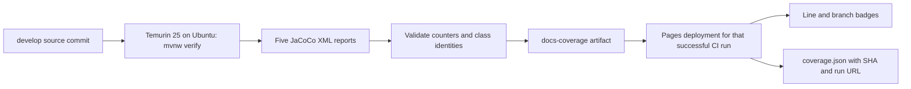

# Build quality and coverage

The project badges link to evidence. Build status comes from GitHub Actions; coverage comes from JaCoCo reports generated by the tested source. Static badges describe the license, minimum Java runtime and CBOM format. They do not certify security or imply that every runtime and enterprise destination has been tested.

## Read the badges

| Badge | What it says | What it does not establish |
| --- | --- | --- |
| CI | Latest GitHub Actions CI workflow status for `develop` | Every advisory job passed, or every possible platform was tested |
| Dependency check | Latest dependency-check workflow status for `develop` | Absence of all vulnerabilities; results depend on the vulnerability database at scan time |
| Documentation | Documentation workflow status | Product test results or commercial destination compatibility |
| Line coverage | Executed source lines divided by measured source lines across five production modules | Workload completeness, cryptographic safety or assertion quality |
| Branch coverage | Executed bytecode branches divided by measured branches across the same modules | Every application behavior or failure mode was tested |
| Apache 2.0 | Repository license | A warranty or security certification |
| Java 17+ | Minimum agent/runtime requirement | A support claim for every future JDK; use the [compatibility matrix](../COMPATIBILITY.md) |
| CycloneDX 1.6 | CBOM output format | A complete software dependency inventory |

The JDK early-access CI job is advisory and uses `continue-on-error`. GitHub can report an overall passing CI workflow while that job fails. Required matrix jobs, Maven dogfooding and application-server conformance are separate gates. Consult the [conformance policy](../CONFORMANCE.md) and the linked run's individual jobs instead of interpreting a green badge as universal compatibility.

## Measured coverage, with provenance

[Download coverage.json](https://developmentsprint.github.io/crypto-census/badges/coverage.json) to inspect the full source commit, producing CI run, measurement time, scope, per-module counts and aggregate percentages. The public badges show the most recently deployed successful, trusted `develop` CI measurement. They can lag the branch tip while a build is running or failing; `sourceSha` and `runUrl` identify exactly which measurement is displayed. Failed builds never replace the measurement with a fabricated zero or a hand-edited percentage.



The aggregation is weighted by the number of measured items:

```text
coverage = sum(covered) / sum(covered + missed) × 100
```

It is **not** an average of module percentages. A module with ten lines contributes ten lines to the denominator, not the same weight as a module with a thousand lines. Both displayed percentages round to one decimal place; the JSON retains integer covered and missed counts.

| Module | Report selected | Execution data represented |
| --- | --- | --- |
| `census-core` | `target/site/jacoco/jacoco.xml` | Module unit tests |
| `census-agent` | `target/site/jacoco-runtime/jacoco.xml` | Child-JVM integration tests plus compatible unit-test data, measured against the agent's own shaded classes |
| `census-delivery` | `target/site/jacoco/jacoco.xml` | Module tests, including local HTTPS protocol fixtures |
| `census-cli` | `target/site/jacoco/jacoco.xml` | Module tests |
| `census-maven-plugin` | `target/site/jacoco/jacoco.xml` | Merged unit-test and Maven Invoker integration data |

The agent's runtime report is used once. Adding its ordinary unit report would double count classes and conceal differences between original and shaded bytecode. JaCoCo accepts unit execution data for a shaded class only when its bytecode checksum matches. The runtime report includes unexecuted agent classes as uncovered and excludes bundled third-party dependencies.

The aggregate excludes the demo, conformance fixture modules, vendored dependencies and documentation. It uses the established report configurations and does not replace per-module coverage floors. Different JVMs can produce different measurements; the badges deliberately use one reproducible CI row, Eclipse Temurin 25 on Ubuntu.

The exporter rejects missing reports, malformed counters, empty denominators, package/report counter mismatches and duplicate class identities within or across reports. This prevents a partial reactor build or accidental report duplication from silently inflating the badge.

## Inspect or reproduce the evidence

1. Open the run linked by `runUrl` in `coverage.json`.
2. Inspect **JDK 25 temurin / ubuntu-latest**, especially **Build, test and analyze** and **Export measured documentation coverage**.
3. Download that run's **docs-coverage** artifact. It contains `coverage.json`, `coverage.svg` and `coverage-branches.svg`. CI retains it for 30 days; the deployed site keeps its published copy until replacement.
4. To examine detailed HTML and XML locally, check out `sourceSha`, select JDK 25 and run `./mvnw -B -ntp verify`. Open each module's `target/site/jacoco/index.html`, using `census-agent/target/site/jacoco-runtime/index.html` for the agent. The Maven plugin report includes Invoker data after `verify` completes.

Run `python3 scripts/coverage_badges_test.py` to check the exporter's aggregation and rejection behavior. CI then invokes `scripts/coverage_badges.py` with the full checked-out commit and actual run URL. Reports are generated build output; percentages are not maintained in source.

## Quality gates and their limits

JDK 21+ builds activate the quality profile: formatting, Checkstyle, Error Prone, compiler warnings as errors, PMD/CPD, SpotBugs/FindSecBugs, Maven Enforcer and JaCoCo coverage floors. JDK 17 runs tests and dependency constraints without analyzers that require a newer JDK. See the [contributor guide](../CONTRIBUTING.md) for local commands.

Coverage is one signal. A covered line can still contain a defect; mocked or fixture-backed tests cannot establish a commercial service's deployed behavior. The enterprise adapters document their validation status and fidelity limitations individually. Use the [safety model](../SAFETY.md), [compatibility matrix](../COMPATIBILITY.md) and [delivery profiles](../DELIVERY-PROFILES.md) alongside the badges when evaluating a deployment.
