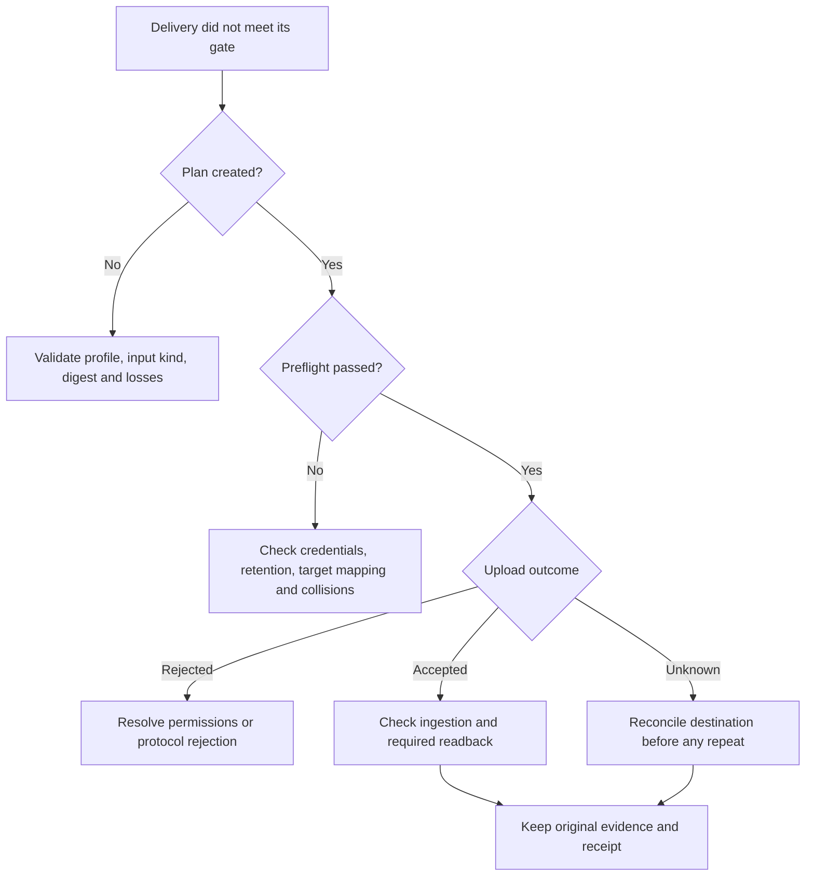

# Troubleshoot enterprise delivery

Read the delivery receipt before resubmitting. An unsuccessful command can follow an accepted remote upload, and a successful upload does not necessarily satisfy ingestion or readback requirements.

## Identify the failing stage

For the profile CLI, exit `2` means invalid input/configuration, `4` means an unsuccessful recorded outcome, and `5` means receipt persistence failed. Exit `0` follows the selected outcome policy: `--report-only` can return success for a recorded delivery failure, so inspect the receipt. Maven's `census.delivery.failOnError=false` has a similar reporting-only role; it does not relax evidence validation.

## Planning fails before networking

Validate the declared schema, exact input kind, trusted SHA-256, correlation values, and supported preparation mode. `CENSUS_MERGED_CBOM` and `EXTERNAL_SOFTWARE_SBOM` use different validation paths; relabeling one as another does not convert it.

A policy must accept the exact named preparation and adapter loss set. A required semantic field must be declared preserved; accepting a loss cannot make an unverified field pass. Read the selected [destination guide](../guides/enterprise-delivery.md#select-a-destination-by-required-evidence) for its capability revision and supported input kinds.

Planning creates immutable preparation outputs. Use fresh preparation/plan paths for a new run or a changed plan, and preserve the original outputs instead of overwriting them. Relative paths resolve against the profile file, not the terminal's working directory.

## A previous plan is rejected

Execution revalidates source bytes, preparation, configuration, capabilities, and configured CA bytes against the plan. Capture the exact printed plan digest and pass it as `--plan-sha256` or `census.delivery.planSha256`.

A changed source file, profile mapping, or CA bundle requires a new plan. Do not replace the expected digest with a hash calculated from whichever file happens to exist at execution time; the expected value belongs in trusted producer/job state. With sealed CI evidence, also verify that every action uses the same manifest/run/application binding.

## Authentication or TLS fails

Confirm that the secret reference exists in the execution environment and matches the adapter's scheme. `ENV_BASIC` needs separate username and password variable names; `MAVEN_SERVER_BASIC` resolves a decrypted pair from Maven settings. The CLI cannot resolve Maven settings server references.

Use the exact endpoint required by the adapter. Credential-bearing URLs, redirects, and unsupported query strings are rejected, including redirects to signed cloud-storage download URLs. Configure direct same-origin retrieval where required rather than expecting credentials to follow a redirect.

Provide the approved CA bundle and explicit proxy settings if your network requires them. Hostname verification remains enabled. Origin credentials and CONNECT proxy credentials are distinct, and Census does not inherit ambient proxy settings or fall back to a direct route.

## Understand specific receipt reasons

| Reason | Meaning | Response |
|---|---|---|
| `ORIGINAL_RETENTION_UNVERIFIED` | Independent original readback did not establish the expected bytes. | Confirm the evidence-store object, permissions, exact hash, and direct HTTPS retrieval. |
| `DESTINATION_READBACK_UNVERIFIED` | Required destination download did not establish exact publication bytes after mutation. | Keep the accepted-upload observation, investigate the stored object, and compare hashes. |
| `UNSAFE_AUTOMATIC_RETRY` | The JDK client is configured to retry all HTTP methods automatically. | Remove `jdk.httpclient.enableAllMethodRetry=true` from the delivery JVM configuration. |
| `UNSAFE_TRANSPORT_LOGGING` | Active transport wire/header logging could expose credentials or payloads. | Disable unsafe HTTP wire/header logging before creating the client; use sanitized Census receipts. |

These reasons describe the shared transport and evidence checks. Vendor-specific reasons add mapping, collision, import, or version information. Use the [delivery operations reference](../DELIVERY-OPERATIONS.md) and the destination's failure section rather than interpreting every reason as a retryable outage.

## Upload is accepted but delivery fails

The receipt keeps acceptance separate from ingestion. A job can fail after submission, report an unknown status, exceed the bounded polling deadline, or identify the wrong mapped object. Sonatype and Artifactory also require exact destination readback; its failure cannot erase the fact that a write may already exist.

Inspect the remote operation using its nonsecret identifier where available, with the destination's own administrative tools. Preserve the publication digest and receipt during reconciliation. Do not create a new target name or version merely to bypass a collision from an ambiguous earlier attempt.

## Upload outcome is unknown

A timeout or disconnect after submission may mean the destination accepted the bytes but the response was lost. Vendor adapters make one upload attempt. Inspect the destination before intentionally resubmitting; no exactly-once guarantee exists.

Generic HTTPS retries require a verified receiver-side idempotency contract and explicit configuration. An operator assertion does not prove the receiver implements that contract. Follow [retry requirements](../DELIVERY-OPERATIONS.md#receiver-retries), including the receiver's key retention window, before enabling them.

## Receipt persistence fails

Treat a receipt write failure as a reconciliation problem, not an instruction to upload again. A remote side effect may already exist. Check private output-directory permissions, free space, and whether any output aliases protected evidence.

Keep preparation, plan, receipt, and immutable run evidence at separate paths. Do not edit original manifests or reports to repair a delivery outcome. Test and crypto-policy failures remain independent of whatever delivery does next.
