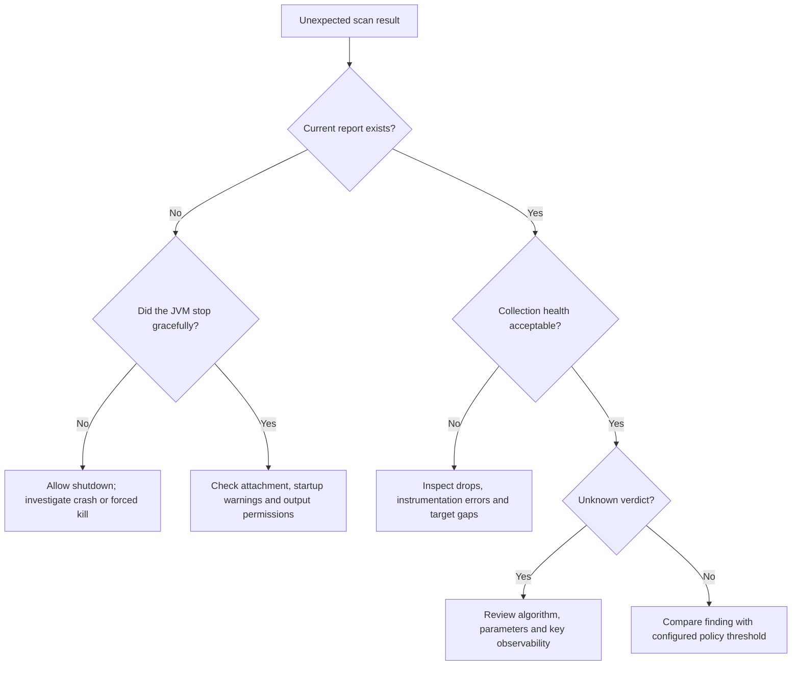

# Troubleshoot collection and policy

Start by separating missing evidence, incomplete observation, and an actual policy finding. Preserve the current run's files and stderr before rerunning or cleaning the build; they explain why the result failed.

## Maven reports no agent data

Check that Surefire and Failsafe fork JVMs. Inspect every execution's `argLine`, remove command-line `-DargLine`, and use [late binding](../examples/maven-project.md#preserve-a-custom-surefire-argument-line) to retain prepared agent arguments. Run through `verify` in the same Maven invocation.

An instrumented execution can produce a report while another execution lacks the agent. Verify each execution separately; one report cannot prove complete test coverage. If you moved test report directories, configure `testReportDirectories` as described in the [Maven reference](../MAVEN.md#custom-report-directories).

Do not disable `failOnMissingData` to repair attachment. Explicitly skipped tests, absent compiled tests, missing reports, and a test JVM that never loaded the agent have different meanings. The [check guarantees](../MAVEN.md#what-check-guarantees) explain how Census distinguishes the evidence it can establish.

## A standalone report never appears

The agent writes at graceful JVM shutdown. A process that is still serving requests has not reached that point, and a process killed with `SIGKILL` cannot flush. Inspect startup stderr for invalid options, unsupported runtime behavior, and output failures.

Verify the destination as the JVM's actual user: the directory must allow file creation and rename. Container mounts need the correct UID/GID or ACL. Preserve an existing report for diagnosis, but do not treat unchanged bytes from a previous process as a successful new run.

## Collection is incomplete

| Evidence | Meaning | Next action |
|---|---|---|
| Dropped assets | Collection reached its asset bound. | Partition the workload or raise `maxAssets` within supported limits, then rerun. |
| Recording or instrumentation errors | Some observations could not be collected. | Check runtime compatibility and enable `debug` for a controlled rerun. |
| Calls in flight at shutdown | Observation was still active during finalization. | Improve graceful shutdown and repeat the workload. |
| `<overflow>` attribution | Some call-site attribution was folded. | Review `maxSites` and serialization budgets; asset counts and verdicts remain, but attribution is incomplete. |
| `not-loaded` target | No observed JVM loaded that target class. | Confirm the workload was intended to exercise it; the status alone is not an instrumentation failure. |
| Missing or untransformed target | The expected instrumentation path has a coverage gap. | Check the exact runtime against the compatibility matrix and inspect target details. |

Lost attribution produces a warning rather than automatically being incomplete collection. It also prevents treating an affected asset as demonstrably JDK-only. See [output budgets](../OPERATIONS.md#output-budgets) before raising limits: asset counts, serialized bytes, and parser memory have separate ceilings.

## The verdict is unknown

`unknown` represents missing or unsupported information, not a low severity. Typical causes include an unrecognized algorithm/mode, an unobservable public or HMAC key size, raw signatures with external hashing, or parameters Census does not capture.

Provider and HSM keys are not exported to discover their size. Review the provider's independently available metadata and the exact operation. AES with an unobserved size has a specific policy treatment because its supported sizes meet the classical floor; do not apply that rule to arbitrary algorithms.

Use a reviewed exception only when you have independent evidence and a documented owner. Read [policy](../POLICY.md) and [exception scope](../MAVEN.md#reviewed-exceptions) before changing the gate. `failOn=none` alone does not disable unknown or evidence failures.

## An unfamiliar JDK fails instrumentation

Use a runtime in the [compatibility matrix](../COMPATIBILITY.md). The standalone `experimental=true` option enables best-effort newer-class parsing; it does not make an unlisted JDK supported. Validate target and health metadata if you deliberately test that option in staging.

For a source build, verify that Maven itself uses JDK 21+ so the full quality toolchain can run. The runtime agent's Java 17 minimum and the repository's full-build requirement are different constraints.

## Finalization refuses a run or manifest

Confirm the exact `census.runId`, module identity, revision, and manifest path. Reused producer identities, symlinks, changed original files, a missing descriptor, and policy drift are rejected intentionally. Do not select a latest directory or edit a manifest to make it pass.

If late JVM evidence arrives, create a new explicit revision as described in [CI finalization](../CI-FINALIZATION.md). Preserve a partial revision after a finalization crash for diagnosis. Delivery failures have a separate [decision tree](delivery.md).

## Prepare a useful support report

Include the Census version, JDK vendor/version, operating system, relevant plugin configuration, exact lifecycle command, and sanitized health/target findings. State whether tests forked and whether shutdown completed gracefully. Exclude credentials, private endpoints, unreviewed CBOMs, and application secrets; use [private vulnerability reporting](https://github.com/DevelopmentSprint/crypto-census/security/advisories/new) for a suspected security issue.
